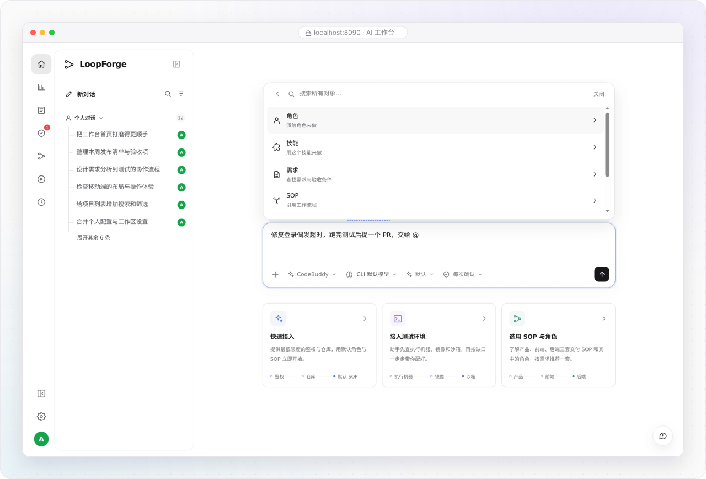
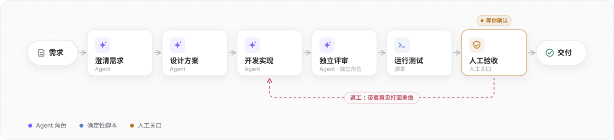

# 认识 LoopForge

> **快速开始 · 01** · 无需编程基础。用日常语言描述你要做的事，让 AI 团队在云端沙箱里按标准流程完成方案设计、编码实现、自动化测试与交付。

## 一句话读懂 LoopForge

**LoopForge** 是一个开源、可自主部署的团队级 AI 研发协作平台。

即使你完全不懂代码、没用过命令行，也可以像和同事聊天一样，把需求告诉工作台里的 **Main Bot（主助手）**。平台会在后台自动打开隔离的云端工作区、安排不同专业岗位的 AI 角色接力干活、运行自动化检查，并在需要做决定的环节停下来请你拍板。

---

## 为什么不只用普通聊天框，而要用 LoopForge？

直接让单次聊天里的 AI「帮我修个 Bug」或「做个新功能」，往往会遇到五个常见的团队协作难题：

| 常见痛点 | LoopForge 的解决方式 |
| --- | --- |
| **合上电脑任务就中断** | 每个任务运行在独立的 **7×24 云端沙箱** 中。你发完任务就可以合上电脑下班，闲置时自动保存快照休眠，次日打开浏览器无缝继续。 |
| **跨岗位信息靠手搬** | 产品、设计、研发共用同一个 **团队共享会话**。需求澄清、设计变更和代码提交都在同一条上下文里流转，不用来回复制粘贴。 |
| **AI 口头说「改好了」其实没测** | 引入 **SOP（标准作业流程）** 与 **客观质量门禁**。不仅让独立角色交叉评审，还通过真实的编译与测试命令退出码（`exit 0`）把关，失败自动附带报错日志打回重做。 |
| **关键决定怕 AI 乱做主** | 提供 **人工审批关口（Human Gate）** 与 **操作确认卡片**。遇到核心方案确认或合并代码前，流程会自动暂停，等你检查产物后点击「确认通过」或「退回返工」。 |
| **同样的坑反复踩** | 每次流程跑完后支持 **AI 运行评测（RSI 复盘）**，自动打出 0–100 分并找出返工卡点，一键把改进建议写回流程或角色规范。 |

---

## 两种核心工作方式：什么时候用哪一种？

在 LoopForge 中，你只需要掌握两种日常工作方式。它们共用同一套项目与需求记录：

### 方式一：在「AI 工作台」与 Main Bot 对话（适合探索与快速改动）

* **适用场景**：头脑风暴、撰写产品方案或周报、快速修改文案或小问题、查询项目当前进度。
* **你怎么操作**：在首页输入框直接用大白话描述想法。如果涉及改代码，Main Bot 会自动在后台开启沙箱工作区并提交 Pull Request（PR）；生成的文件可以在右侧 **产物抽屉** 中直接预览或下载。

### 方式二：运行「SOP 标准流程」（适合正式功能与可重复交付）

* **适用场景**：正式产品需求开发、需要经过「澄清 → 设计 → 实现 → 独立评审 → 测试 → 人工验收」完整把关的任务。
* **你怎么操作**：在对话中让 Main Bot 启动某条 SOP，或在「需求列表 / 流程模板」中点击运行。平台已内置 **通用产品方案、通用前端交付、通用后端交付、通用缺陷修复** 四条成熟流程，复制即可直接用。

---

## 平台版与 Local 本地版有什么区别？

LoopForge 提供两种形态，本手册主要介绍功能完整的 **平台版（Web 工作台）**：

| 对比维度 | LoopForge 平台版（Web 工作台） | LoopForge Local（本地 CLI 插件） |
| --- | --- | --- |
| **适合谁用** | 整个团队（包含产品、设计、测试、研发及零代码背景成员） | 习惯在个人终端 / IDE 中写代码的开发者 |
| **使用入口** | 打开浏览器网页即可使用，支持多人共享会话与可视化画布 | 在 Claude Code、Codex、Cursor、CodeBuddy、Pi 中输入命令调用 |
| **运行环境** | 平台托管的 7×24 Docker 云端沙箱，或绑定的团队执行机器 | 开发者自己电脑上的本地目录 |
| **核心优势** | 可视化 SOP 编排、人工审批中心、需求看板、AI 定时任务与效能统计 | 免部署服务端，一行 `npx -y loopforge-cli@latest install` 即装即用 |

> **新手建议**：如果你是第一次接触 LoopForge，请直接按照下一节认识几个常见词，然后花 3 分钟跑通一次免配置体验流程。

---

[返回文档总目录](../README.md) | 下一篇：[核心概念白话词典](02-core-concepts.md) →
