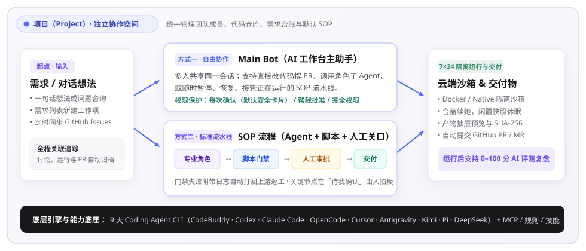

# 核心概念白话词典

> **快速开始 · 02** · 在开始操作前，花 2 分钟了解页面上最常出现的 10 个词。你可以把整套系统想象成一家分工明确的「AI 软件工坊」。

## 把 LoopForge 想象成你的 AI 协作团队

如果你以前没有接触过软件工程或 AI 编排工具，不用担心任何英文缩写。下面这张表把平台里的核心概念翻译成了最直观的日常比喻：

| 页面上的名称 | 日常比喻 | 它在平台里具体指什么？ |
| --- | --- | --- |
| **项目（Project）** | **一个独立的工作间** | 用来把不同产品或业务隔离开。每个项目有自己的成员、需求列表、代码仓库和专属流程。页面右上角随时可以切换当前所在的项目。 |
| **需求（Requirement / Issue）** | **一张任务单** | 你想让 AI 完成的一件具体事项（例如「新增订单状态筛选」或「修复导出时间差 8 小时」）。每一条需求都会全程记录它的讨论、运行进度和最终交付物。 |
| **Main Bot（主助手）** | **接待你的项目总管** | 在「AI 工作台」里直接和你聊天的人。你把想法告诉它，它负责理解意图：简单的事当场办完，复杂的事帮你分派给专业角色或启动整套 SOP 流程。 |
| **角色（Agent Role）** | **不同工种的专科同事** | 比如「需求分析师」「架构师」「前端开发」「独立评审员」「测试工程师」。每个角色都有自己专属的工作守则、工具箱和必交作业。 |
| **执行器（Executor）与 API Key** | **底层干活的 AI 引擎与工牌钥匙** | 平台支持调度 **CodeBuddy、Codex、Claude Code、OpenCode、Cursor、Antigravity、Kimi Code、Pi、DeepSeek Harness** 共 9 种主流 AI 编码引擎。由于开源版运行在你们自己的机器上，需要填入对应的 **API Key（模型钥匙）** 才能让它们开口说话和干活。 |
| **SOP（流程模板）** | **标准办事流水线** | 把「先由谁分析、再由谁写代码、接着跑什么测试、最后由谁签字」固定下来的一套步骤图。选好 SOP 后，每个新需求都会严格按这套步骤推进。 |
| **人工关口（Human Gate）** | **等你签字的检查站** | SOP 流程里的特殊步骤。跑到这一步时，AI 会自动停下来把阶段报告或代码摆出来，等你到 **「待我确认」** 页面点击「通过」或「退回返工」。 |
| **云端沙箱（Workspace）** | **隔离的云端施工房间** | AI 修改代码、运行测试时使用的独立容器环境。里面的操作不会影响你自己的电脑，而且合上电脑后依然在云端继续运行。 |
| **产物（Artifact）** | **交差用的正式成果文件** | AI 完成任务后交出来的文档（如 `requirement.md`、`design.md`）、测试报告或代码补丁。在聊天窗右侧抽屉或运行详情页都能直接预览和下载。 |
| **MCP / 规则 / 技能** | **给 AI 配备的外接工具、制度与操作手册** | **MCP** 让 AI 能连接外部系统（如查文档、操作仓库）；**规则** 是必须遵守的红线约定；**技能（Skill）** 是某项具体工作的标准化操作包。 |

---

## 两个新手最容易混淆的问题

### 1. 「Main Bot」和「角色（Role）」有什么关系？

* **Main Bot** 是你在首页聊天框里直接对话的对象。
* 当任务比较复杂时，Main Bot 不会自己一个人硬扛所有事，而是像项目经理一样，在后台把「方案设计」交给架构师角色、把「代码审查」交给独立评审员角色，最后把结果汇总汇报给你。
* 你也可以在聊天框里输入 `@`，直接点名某个具体角色来回答你的问题。

### 2. 「对话」和「运行（Run）」是一回事吗？

* **对话** 是你在「AI 工作台」里和 Main Bot 你一言我一语的聊天过程。
* **运行（Run）** 是指某一条 **SOP 流程** 被正式启动后，从第一个节点跑到最后一个节点的完整执行记录。你可以在左侧导航的 **「运行记录」** 中看到每一步的亮灯状态（绿色完成、蓝色运行中、橙色待审批、红色失败）。

---

← 上一篇：[认识 LoopForge](01-what-is-loopforge.md) | [返回文档总目录](../README.md) | 下一篇：[界面布局与导航速览](03-interface-tour.md) →
