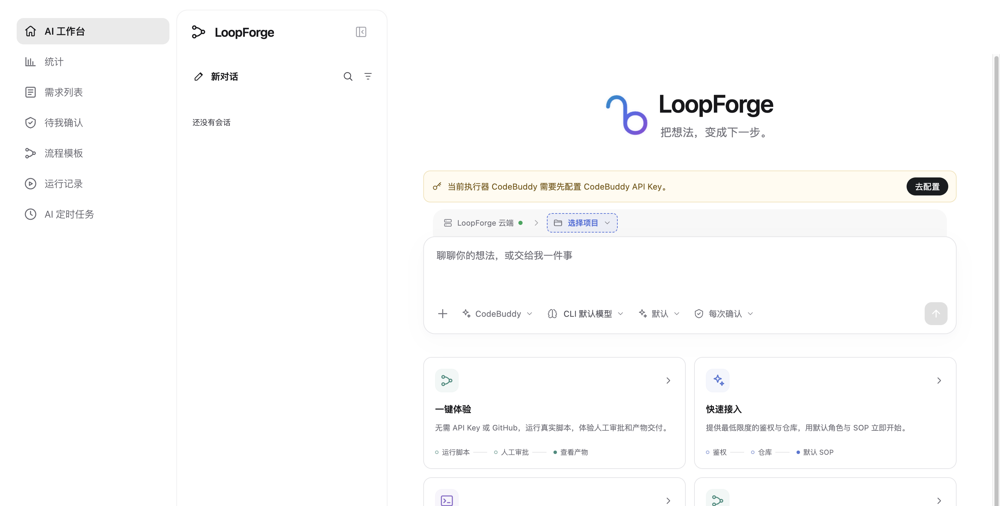

# 界面布局与导航速览

> **快速开始 · 03** · 登录 LoopForge 后，整个界面由「左侧全局图标栏」「中间二级面板」和「右侧主工作区」三部分组成，干净清爽、不会迷路。

## 屏幕三大区域

打开 LoopForge 工作台后，界面按从左到右分为三块：

1. **最左侧：全局图标栏（默认收起）**
   * 默认保持 56px 窄栏状态，只显示清晰的图标，把最大的屏幕宽度留给你的核心内容。
   * 鼠标悬停在任意图标上，右侧会立即浮现它的中文名称；如果你希望一直显示文字标题，可以点击左下角齿轮上方的 **「展开导航」** 按钮。
2. **中间栏：二级侧栏（按页面智能显隐）**
   * 当你在 **「AI 工作台」** 时，这里显示你的 **历史对话列表** 与 **正在运行的任务**。
   * 当你点击左下角的 **「设置」** 时，这里切换为完整的 **设置与管理菜单**。
   * 当你切换到「需求列表」「待我确认」「运行记录」「流程模板」等业务页面时，中间栏会**自动收起隐藏**，让表格和画布铺满整个屏幕。
3. **右侧大区域：主工作区与顶部工具栏**
   * 呈现当前所选模块的具体内容。除 AI 工作台外，页面顶部会显示全局搜索框、当前项目切换器以及语言切换按钮。

---

## 左侧图标栏入口一览

从上到下，左侧图标栏包含以下日常入口：

| 图标位置 | 入口名称 | 一句话说明它的用途 | 新手使用频率 |
| --- | --- | --- | --- |
| 顶部第 1 个（房子） | **AI 工作台** | 和 Main Bot 聊天、提需求、看实时产物的地方，日常大部分时间待在这里。 | ⭐⭐⭐⭐⭐ 每天必用 |
| 顶部第 2 个（柱状图） | **统计** | 查看当前项目的 Token 消耗、成本估算与运行次数统计。 | ⭐⭐ 按需查看 |
| 顶部第 3 个（清单） | **需求列表** | 集中管理项目里的所有需求与缺陷，支持列表与看板视图切换。 | ⭐⭐⭐⭐ 高频使用 |
| 顶部第 4 个（盾牌对勾） | **待我确认** | 所有停在「人工审批节点」等你拍板的任务都会汇总到这里，有待办时会亮起红色数字角标。 | ⭐⭐⭐⭐⭐ 高频使用 |
| 顶部第 5 个（分支节点） | **流程模板** | 查看和选用现成的 SOP 标准流水线（包含本项目、团队共享与平台内置模板）。 | ⭐⭐⭐ 常用 |
| 顶部第 6 个（播放键） | **运行记录** | 查看每一次 SOP 流程跑到哪一步了、花了多少时间、产出了什么文件，以及发起 AI 复盘评测。 | ⭐⭐⭐⭐ 高频使用 |
| 顶部第 7 个（时钟） | **AI 定时任务** | 设置按天/按周自动执行的 AI 任务（例如每天早上 9 点自动巡检或汇总进展）。 | ⭐⭐ 进阶使用 |
| 底部区域（分栏框） | **展开导航 / 只显示图标** | 切换左侧图标栏是「仅显示图标」还是「展开显示图标 + 文字」。 | 按个人习惯 |
| 底部区域（齿轮） | **设置** | 进入个人配置（填 API Key、连 GitHub）、项目配置、角色定义、流程设计等管理后台；再点一次即可返回工作台。 | ⭐⭐⭐ 初次配置必用 |
| 底部最下方（圆形头像） | **个人信息与外观** | 查看当前登录账号、切换 **浅色 / 深色 / 跟随系统** 主题外观，或退出登录。 | 按需使用 |

---

## 顶部全局控制栏

当你离开「AI 工作台」进入其他页面（如需求列表、待我确认、运行记录）时，页面顶部会常驻三个非常实用的工具：

1. **全局搜索框（快捷键 `⌘K` 或 `Ctrl+K`）**
   * 点击顶部搜索框或直接按下键盘上的 `⌘K`（Windows 为 `Ctrl+K`），可以快速搜索并跳转到任意页面、需求、运行记录、SOP 模板或 Agent 角色。
2. **全局项目切换器（右上角下拉框）**
   * 显示当前正在查看的项目名称（首次登录后默认为 **`LOOP · LoopForge 体验项目`**）。
   * 需求列表、待我确认、运行记录和流程模板的数据都是**按项目隔离**的。如果你发现列表是空的，先看一眼右上角是不是选对了你们团队的项目。
3. **界面语言切换（`中 / EN`）**
   * 点击右上角的 `中 / EN` 按钮，可以在简体中文与英文管理界面之间一键切换。

---

← 上一篇：[核心概念白话词典](02-core-concepts.md) | [返回文档总目录](../README.md) | 下一篇：[安装与启动](00-install.md) →
