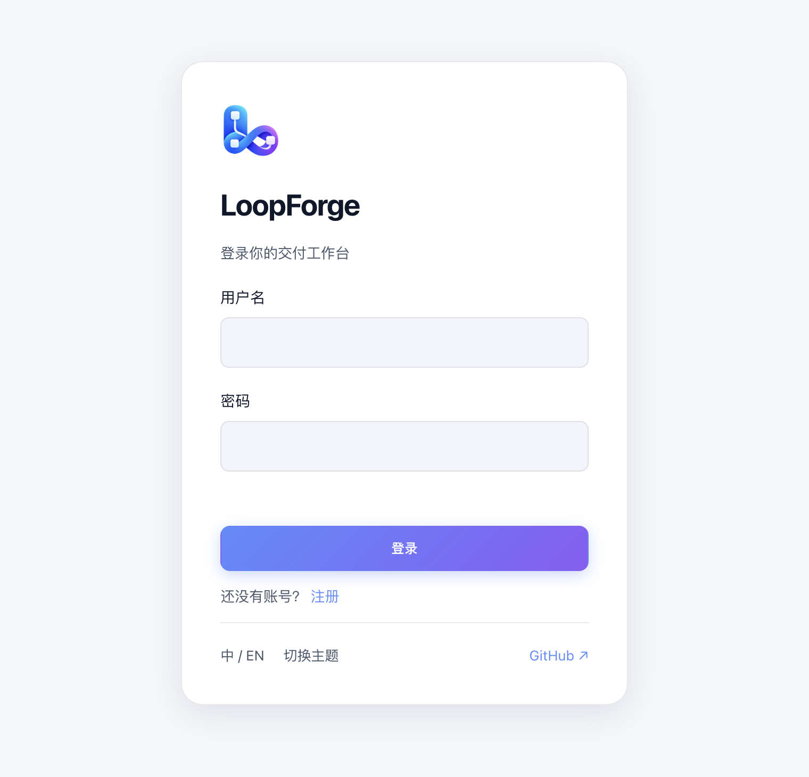

# 账号注册与首次登录

> **快速开始 · 04** · 无论你是访问同事搭建好的团队网址，还是自己用 Docker 启动服务，只需 1 分钟即可完成登录并进入默认体验项目。

## 两种常见进入方式

### 情况一：团队管理员已经部署好，发给你一个网址

如果你们团队已经搭建好了 LoopForge，直接用浏览器打开同事发给你的网址即可：

1. **如果你已经有账号**：输入用户名和密码，点击 **「登录」**。
2. **如果你还没有账号**：
   * 查看登录按钮下方是否有 **「还没有账号？注册」**。如果有，点击 **「注册」**，填写用户名和至少 6 位数的密码即可直接创建账号并登录。
   * 如果页面上没有「注册」入口（说明管理员关闭了公开自助注册），请把你的用户名发给团队的平台管理员，由管理员在 **「设置 → 平台管理 → 成员账号」** 中为你开通。

---

### 情况二：自己装好的服务（第一个账号自动成为管理员）

安装步骤在 [安装与启动](00-install.md)。服务起来后，用浏览器打开终端打印的地址（默认是 `http://localhost:8090`）：

1. 登录卡片顶部会显示一条提示：**「这是首次启动。创建的第一个账号将成为平台管理员。」**
2. 填写你想要的管理员用户名、密码（至少 6 位）并确认密码，点击提交。
3. **请务必牢记该密码**：这个账号拥有全站最高管理权限（可管理所有项目、配置全局开关、为其他同事创建账号）。

> **开发者提示**：如果你是通过源码开发脚本 `bash scripts/dev.sh` 启动的本地环境，脚本会自动创建默认管理员账号 `admin`，并将随机生成的密码保存在项目目录下的 `.local/admin-password` 文件中。

---

## 登录后第一件事：确认默认项目

登录成功后，你会直接进入 **「AI 工作台」**。

系统已经贴心地为所有新实例预置了一个开箱即用的演示空间——**`LOOP · LoopForge 体验项目`**。

* 当你切换到「需求列表」「待我确认」或「流程模板」页面时，右上角的项目下拉框默认就会选中 **`LOOP · LoopForge 体验项目`**。
* 在「AI 工作台」的聊天输入框上方，如果看到按钮显示为 **「选择项目」**，点击它并选择 **「LoopForge 体验项目」**，即可在该项目中发起对话。

接下来，我们先不用配任何 API Key，直接点一下首页卡片来体验一次完整的自动化流程。

---

← 上一篇：[安装与启动](00-install.md) | [返回文档总目录](../README.md) | 下一篇：[第一步：3 分钟免配置体验](05-try-without-key.md) →
