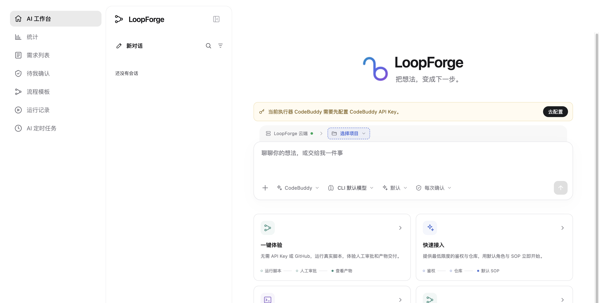
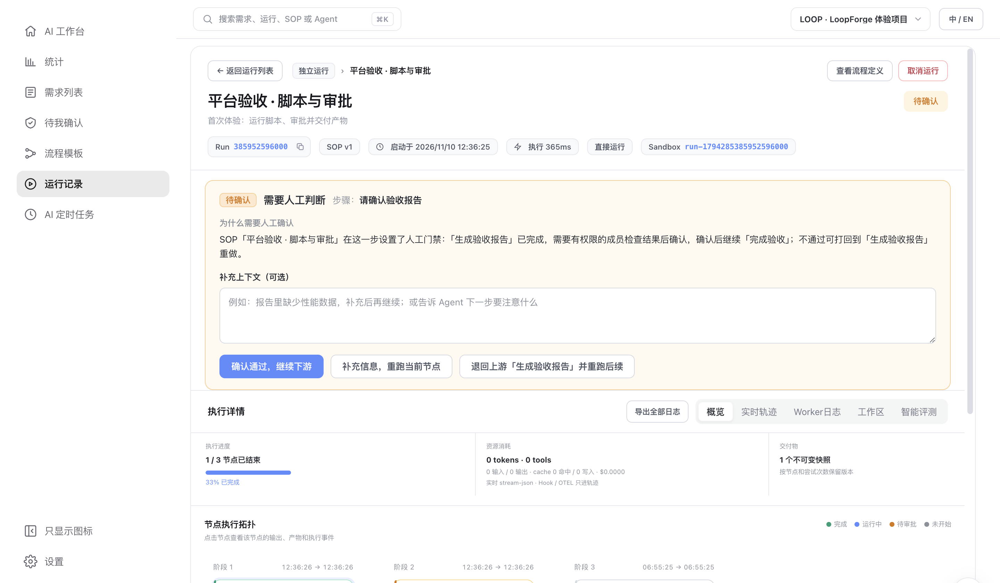
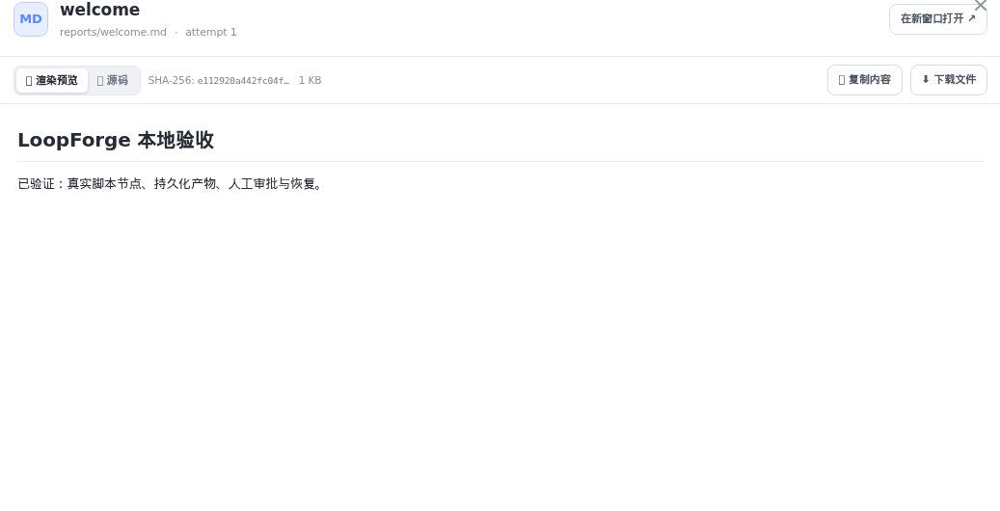

# 第一步：3 分钟免配置体验

> **快速开始 · 05** · 不用申请模型 API Key，也不用绑定 GitHub 仓库。点击首页的「一键体验」，亲手走完一次「脚本执行 → 人工审批 → 产物交付」的真实流程。

## 为什么可以先免配置体验？

很多新同学第一次打开 AI 平台时，手里还没有配置大模型 API Key，看到输入框上方的黄字提示（`当前执行器 CodeBuddy 需要先配置 CodeBuddy API Key`）可能会不知道该点哪里。

为了让你在零准备的情况下也能直观感受 LoopForge 的工作流运转，平台内置了一条不需要调用外部大模型的验收流程——**「平台验收 · 脚本与审批」**。它包含一个真实运行的脚本步骤和一个人工审批步骤。

---

## 第一步：在首页点击「一键体验」

1. 点击左侧图标栏最上方的房子图标，回到 **「AI 工作台」** 首页。
2. 在输入框下方的四张快捷卡片中，找到第一张 **「一键体验」**（标注着 *无需 API Key 或 GitHub，跑通真实脚本、人工审批与交付产物*）。
3. 直接点击 **「一键体验」** 卡片。

> **另一条入口**：你也可以点击左侧图标栏的 **「流程模板」**，在「本项目」下找到 **「平台验收 · 脚本与审批」**，点击进入后按右上角的 **「▶ 运行流程」**，效果完全一样。

---

## 第二步：观察流程停在「人工审批关口」

点击「一键体验」后，页面会自动跳转到本次运行的详情页：

此时你会看到系统已经在后台完成了第一阶段，并停下来等你拍板：

1. **查看下方「节点执行拓扑」**：
   * 第 1 步 **「生成验收报告」**（脚本节点）已经变成绿色的 **已完成** 状态，在隔离沙箱里真实生成了一份 `reports/welcome.md` 报告文件。
   * 第 2 步 **「请确认验收报告」**（人工审批节点）正亮着橙色边框，状态为 **待审批**。
   * 第 3 步 **「完成验收」** 处于 **等待中**，必须等你批准第 2 步后才会继续推进。
2. **查看中间醒目的黄色审批框（「需要人工判断」）**：
   * 这里写明了当前停在哪一步，并提供了一块可选的「补充上下文」输入框和三个操作按钮。

---

## 第三步：点击「确认通过」并查看交付物

现在，你就是这条流水线上的审批把关人：

1. 在黄色审批框中，直接点击蓝紫色的主按钮 **「确认通过，继续下游」**（你也可以先在文本框里随便写一句批注，比如 `报告已阅，同意放行`，再点确认通过）。
2. 点击后只需等待 1～2 秒，第 2 步和第 3 步 **「完成验收」** 就会依次变成绿色完成状态，整条运行的状态标签变为 **已完成**。
3. **在运行详情页的「交付物」区域点击 `reports/welcome.md`**，即可弹出预览窗口，直接查看渲染后的报告内容、源码以及防篡改的 SHA-256 校验值：

**恭喜你！** 到这里，你已经掌握了 LoopForge 最核心的「自动化流水线 + 人工把关放行」机制。接下来，如果你希望让 AI 真正开口回答你的问题、帮你写方案或改代码，只需花 2 分钟配置一把模型钥匙（API Key）。

---

← 上一篇：[账号注册与首次登录](04-account-and-login.md) | [返回文档总目录](../README.md) | 下一篇：[第二步：配置模型 API Key](06-configure-api-key.md) →
