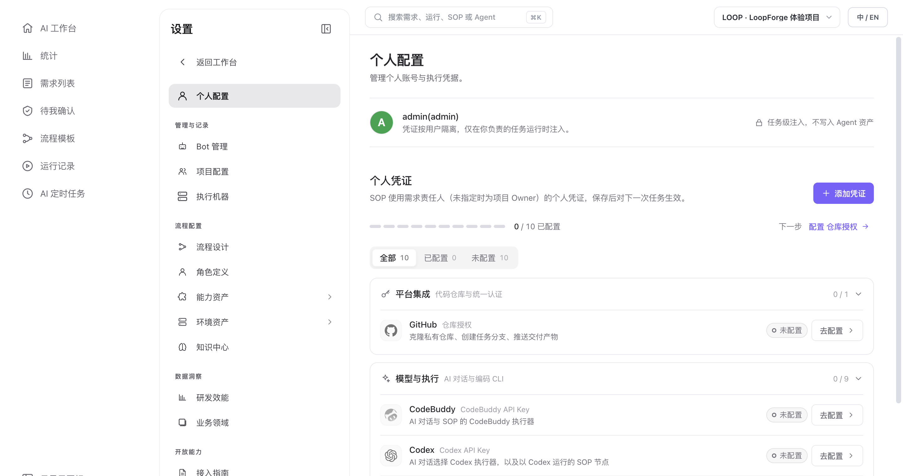

# 第二步：配置模型 API Key

> **快速开始 · 06** · 当你希望和 Main Bot 自由聊天、让 AI 撰写文档或编写代码时，需要在「个人配置」中填入对应执行器的 API Key。

## 什么时候需要配置 API Key？

开源版 LoopForge 完全运行在你们自己的服务器或电脑上，平台本身不捆绑售卖任何大模型额度。你可以根据自己要做的事，按需准备凭证：

| 你想在平台里做的事 | 需要准备什么凭证？ | 在哪里配置？ |
| --- | --- | --- |
| 跑通刚才的「一键体验」（脚本 + 人工审批） | **什么都不需要** | 无需配置 |
| 在 AI 工作台与 Main Bot 聊天、写方案、跑 SOP | **所选 CLI 执行器的个人 API Key**（共支持 9 种 Coding Agent 执行器，见下表） | 左下角 **设置 → 个人配置 → 模型与执行** |
| 让 AI 拉取你们已有的 GitHub 代码仓库、修改代码并自动提交 PR | **上述模型 API Key** ＋ **GitHub 仓库授权** | 左下角 **设置 → 个人配置 → 平台集成** |

---

## 9 种 Coding Agent 执行器怎么选、怎么填？

平台目前支持 **9 种主流 Coding Agent 执行器**。它们在填写凭证时的要求可分为四类：

| 分类 | 包含的执行器 | 填写时的关键要求 |
| --- | --- | --- |
| **1. 默认主力（按站点区分）** | **CodeBuddy**（默认） | 需先选择账号所在的 **网络环境**（`国际站 codebuddy.ai` 或 `国内站 copilot.tencent.com`），再粘贴以 `ck_` 开头的个人 Key。 ⚠️ **注意**：DeepSeek、OpenAI 等第三方 `sk-` 开头的 Key 不能填在这里（会报 401）。 |
| **2. 官方直连（仅填 Key）** | **Cursor CLI** | 只连接 Cursor 官方服务。在 Cursor 控制台 `Integrations → User API Keys` 创建以 `crsr_` 开头的 Key 粘贴即可，无需填写 Base URL。 |
| **3. 自带官方地址 + 可选网关与协议** | **Codex** **Claude Code** **Kimi Code** **DeepSeek Harness** **Antigravity** | • **Codex / Claude Code**：留空 Base URL 默认连接官方服务；走代理或第三方网关时填写 Base URL。 • **Kimi Code / DeepSeek Harness**：留空 Base URL 默认连接 Moonshot / DeepSeek 官方服务；支持按需切换 **接口协议**（`Chat Completions` / `Responses` / `Messages`）。 • **Antigravity**：选 `Gemini 官方 API` 时使用 Google AI Studio Key（无需填 Base URL）；若选 `OpenAI 兼容网关` 则 **必须填写 Base URL**。 |
| **4. 纯网关驱动（Base URL 必填）** | **OpenCode** **Pi** | 这两款 CLI 本身没有官方模型服务，配置时 **必须同时填写 `API Key`、模型服务 `Base URL`（必填）以及 `接口协议`**。 |

---

## 手把手配置模型钥匙（3 步完成）

如果你在 AI 工作台输入框上方看到了黄色提示条（`当前执行器 CodeBuddy 需要先配置 CodeBuddy API Key`，或切换其他 CLI 时提示 `请先在个人配置中配置 XXX API Key 后再使用 XXX 模型`）：

1. **打开个人配置页**
   * 直接点击黄色提示条右侧的黑色按钮 **「去配置」**；或者点击左下角的齿轮图标 **「设置」**，默认打开的就是 **「个人配置」** 页面。
2. **选择你要使用的执行器并填入凭证**
   * 在页面下方的 **「模型与执行」** 区域（或点击右上角 **「＋ 添加凭证」** 向导），找到你要用的执行器卡片并点击 **「去配置」**。
   * 按上表要求粘贴 API Key（以及对应的网络环境、Base URL 或接口协议），点击保存。保存成功后，卡片状态会从「未配置」变为绿色的 **「已配置」**。
3. **生效规则说明**
   * 个人凭证保存后，对**下一次新发起的对话和任务**立即生效。
   * 你平时在聊天框或 SOP 角色里用哪个执行器，就配哪一个的凭证，**不需要把 9 个全部配齐**。

---

## 新手必读：凭证安全与生效机制

* **钥匙只保存在个人配置里**：请勿把你的 API Key、GitHub Token 或密码直接发在聊天对话框里，也不要写进需求描述或公开文档中。
* **不会写代码去哪里拿 Key？** 如果你是团队里的产品、设计或运营同学，自己手里没有申请过大模型 API Key，请直接联系帮你们搭建平台的管理员或研发同事，由他们提供一个团队测试 Key 供你填入，或者让他们将项目配置好后供你调用。
* **SOP 运行时用谁的 Key？** 当一条需求被派发运行 SOP 流程时，系统默认使用**该需求责任人**（若未指定责任人，则使用**项目 Owner**）在个人配置里保存的凭证。

---

← 上一篇：[第一步：3 分钟免配置体验](05-try-without-key.md) | [返回文档总目录](../README.md) | 下一篇：[第三步：发起第一个任务](07-first-conversation.md) →
