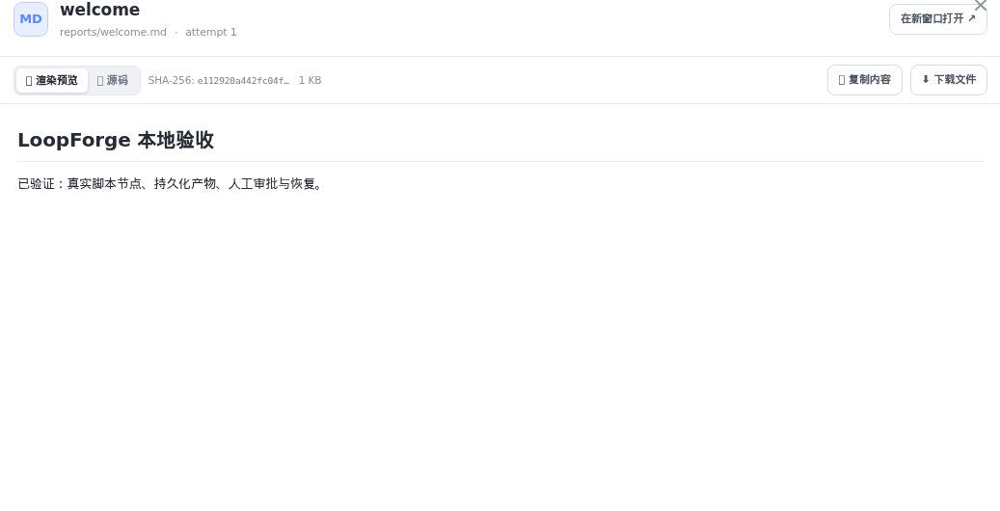

# 第三步：发起第一个任务

> **快速开始 · 07** · 配好模型 API Key 后，回到 AI 工作台。用日常语言向 Main Bot 交代一件事，体验「对话生成文档」与「确认卡片创建需求」。

## 发起对话的 4 个标准动作

点击左侧图标栏第一个房子图标回到 **「AI 工作台」**，按照下面 4 步发出你的第一条正式指令：

1. **开启新对话**：点击左侧会话栏顶部的 **「＋ 新对话」**。
2. **确认归属项目**：看一眼输入框左上角的项目按钮。如果显示为 **「选择项目」**，点开它并选中 **「LoopForge 体验项目」**（或你们自己的业务项目）。
3. **输入你的想法**：在中间大输入框（「聊聊你的想法，或交给我一件事」）里，像平时发微信一样写清楚你要做的事。
4. **点击发送**：点击输入框右下角的上箭头按钮（或按回车）发送。

---

## 实战练习 A：让 AI 帮你写一份方案并预览产物

如果你是产品、运营或零编程基础的同学，可以先试试下面这段话（直接复制粘贴到输入框即可）：

> **示例指令**：
> `帮我写一份「用户意见反馈弹窗」的轻量产品方案，包含功能目标、界面包含的 3 个字段、以及提交后的处理逻辑，整理成一份清晰的 Markdown 文档。`

发送之后会发生什么？

* 你的话会显示在右侧气泡，Main Bot 的思考过程与回复显示在左侧。
* 当 Main Bot 生成文档文件后，聊天界面右侧可以打开 **产物抽屉 / 预览窗口**，在里面直接切换 **「渲染预览」** 和 **「源码」**，或者点击 **「复制内容」 / 「下载文件」** 把方案拿走使用。
* 如果觉得某一点写得不够好，不需要重写长段话，直接追问：`把第 2 点改得更精简一点，去掉复杂的上传图片功能。`

---

## 实战练习 B：让 AI 帮你登记一条需求（体验安全确认卡片）

接下来，试试让 Main Bot 帮你在当前项目里创建一条正式的工作项：

> **示例指令**：
> `帮我在当前项目里新建一条需求，标题叫「支持导出最近 30 天的反馈记录」，优先级设为高，并在说明里列出验收标准。`

因为输入框底部的权限模式默认处于最安全的 **「每次确认」** 状态，你会看到一个非常贴心的保护机制：

1. **AI 不会自作主张直接修改系统**：Main Bot 整理好需求标题、说明和优先级后，会在对话流里弹出一张 **「待确认操作卡片」**。
2. **由你拍板决定**：
   * 卡片上会清楚写明它准备在哪个项目创建什么需求。
   * 你检查无误后，点击卡片上的确认/批准按钮，这条需求才会真正写入系统。
   * 如果你觉得标题不对，点击拒绝并在输入框里告诉它怎么改即可。
3. **去需求列表验证结果**：批准后，点击左侧图标栏的第 3 个图标 **「需求列表」**，就能在表格里看到刚刚由 AI 帮你建好的那条需求了！

---

← 上一篇：[第二步：配置模型 API Key](06-configure-api-key.md) | [返回文档总目录](../README.md) | 下一篇：[发起对话、排队与实时引导](../02-workspace/01-ai-workbench.md) →
