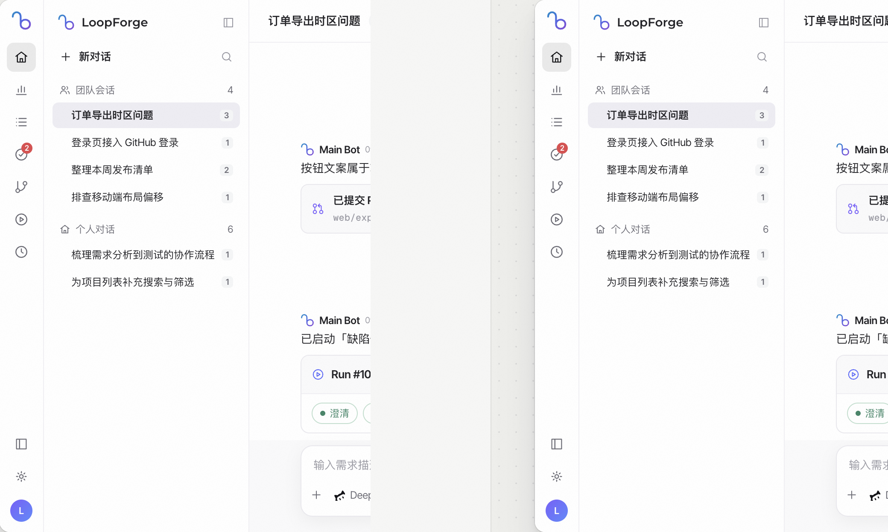
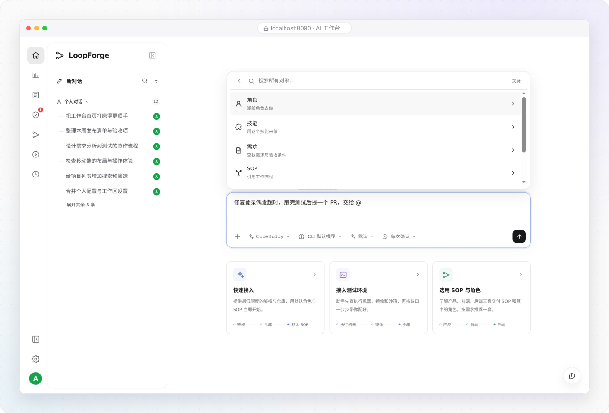

# AI 工作台：发起对话、排队与实时引导

> **日常工作区 · 01** · AI 工作台是团队每天待得最久的地方。它不仅支持单人问答，还支持产品、设计、研发在同一个共享会话里围绕 Main Bot 协同推进任务。

## 对话侧栏与多人共享会话

在 AI 工作台左侧的二级面板中，管理着你所有的对话与任务运行：

* **新建与搜索会话**：点击顶部的 **「新对话」** 可随时开启全新上下文；右侧的放大镜图标支持按关键词搜索历史会话。
* **会话右键菜单**：在任意一条会话上点击鼠标右键（或触屏长按、按键盘菜单键），可以执行 **置顶、重命名、归档、删除**。
* **多人共享同一个会话**：
  * 当会话关联到某个具体项目后，该项目的所有成员（包括只读成员）都可以打开同一个会话链接，看到完全一致的聊天历史、绑定的云端工作区与阶段产物。
  * 产品经理提完需求背景后，设计师可以在同一个会话里补充视觉规范，研发同事接着让 Main Bot 派发 SOP 或提交 PR，上下文全程不断裂。

---

## 首页下方另外 3 张快捷卡片怎么用？

除了我们在快速开始里点过的「一键体验」，首页输入框下方还有 3 张常用引导卡片。它们不是必选项，但能帮你省去打字：

| 快捷卡片名称 | 点击后会发生什么？ | 适合谁点？ |
| --- | --- | --- |
| **快速接入** | 将一段引导词填入输入框，发送后 Main Bot 会一步步带你检查模型凭据、绑定代码仓库并挑选项目的默认 SOP。 | 第一次帮团队搭建项目、接入仓库的负责人。 |
| **接入测试环境** | 将测试环境检查指令填入输入框，发送后由 Main Bot 带你梳理运行环境与沙箱配置还缺什么。 | 需要配置测试环境或容器沙箱的研发同学。 |
| **选用 SOP 与角色** | 将选用流程与角色的说明填入输入框，你可以在末尾补上自己的具体需求再发送。 | 想按标准流程跑需求、但拿不准该选哪条 SOP 的同学。 |

---

## 进阶技巧：AI 正在回复时，怎么「排队」或「实时引导」？

当 Main Bot 正在长篇思考或在沙箱里执行多步工具调用时，你不需要干等着它全部跑完才能说话：

1. **消息排队（Queue）**
   * 在 AI 回复过程中，你在输入框里继续打字并发送，新消息会自动进入输入框上方的 **排队托盘**。
   * 等当前这一轮回复正常结束后，系统会自动按顺序发出你排队的下一条指令。
2. **实时引导（Steer / 打断纠偏）**
   * 如果你看到 AI 正在往错误的方向走（比如选错了目录、或者漏掉了一个前提条件），可以在排队消息旁点击 **「引导」**。
   * 系统会立即打断当前正在进行的生成，把你的纠偏指令当场注入进去，让 AI 马上按新要求调整方向，避免浪费时间和 Token。

---

← 上一篇：[第三步：发起第一个任务](../01-getting-started/07-first-conversation.md) | [返回文档总目录](../README.md) | 下一篇：[输入框工具栏与权限模式](02-toolbar-and-permissions.md) →
