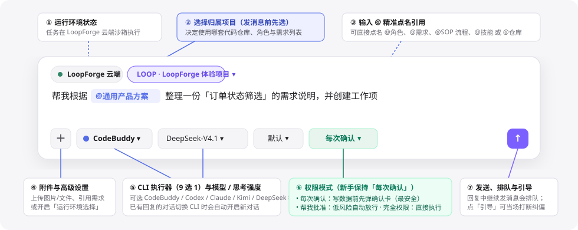

# 输入框工具栏与权限模式详解

> **日常工作区 · 02** · 聊天输入框底部有一排紧凑的控制按钮，用来决定「这次任务在哪个项目做、用哪个模型引擎、想多深、以及做修改前要不要先问过你」。

## 输入框底部按钮逐个看

在「聊聊你的想法，或交给我一件事」输入框四周，分布着 6 个控制项。新手只需了解它们的含义，绝大多数时候保持默认即可：

| 按钮位置与显示名称 | 它的作用是什么？ | 新手操作建议 |
| --- | --- | --- |
| 左上角 **选择项目** | 决定本次对话归属哪个项目（决定使用哪套仓库、角色与需求列表）。 | 提问前先点开选好目标项目（如 `LoopForge 体验项目`）。 |
| 左下角 **`＋`（加号）** | 上传本地图片、文档附件，或者直接从列表里引用一条已有需求，还可以开启「高级设置 → 显示运行环境选择」。 | 需要发截图、发参考文档给 AI 看时点击。 |
| 底部左二 **`CodeBuddy`**（CLI 执行器选择） | 选择本次对话底层由哪个 AI 编码 CLI 干活（菜单标题为 `CLI`，支持 `CodeBuddy`、`Codex`、`Claude Code`、`OpenCode`、`Cursor`、`Antigravity`、`Kimi Code`、`Pi`、`DeepSeek Harness` 共 9 种）。 | **注意**：一个对话在收到第一条回复后就绑定了该 CLI；如果你在菜单里切换成另一个 CLI，系统会自动为你开启一条使用新 CLI 的新对话。 |
| 底部中间 **`CLI 默认模型`**（模型选择） | 选择当前执行器下的具体大模型版本。带官方目录的执行器会直接列出可选模型，接入自定义网关的（如 `OpenCode`、`Pi`）支持自定义模型 ID。 | 看不懂模型代号时，直接保留默认模型即可。 |
| 底部中右 **`默认`**（思考强度） | 控制模型的推理深度（根据所选执行器与模型自动适配 `关闭 none`、`低 low`、`中 medium`、`高 high`、`最大 max`、`极致 ultra` 等档位）。 | 日常对话保持 `默认`；遇到特别复杂的架构分析可调高。 |
| 底部右侧 **`每次确认`**（权限模式） | 控制 AI 在修改平台数据或执行高风险操作前，是否必须先经过你批准。 | **强烈建议新手保持默认的 `每次确认`**（详见下方对比表）。 |

---

## 三种权限模式：我该选哪一种？

点击输入框底部的权限按钮，可以在三种模式之间切换。这是保障零代码用户安全使用 AI 的核心开关：

| 权限模式 | 英文界面名称 | 具体行为说明 | 适用场景 |
| --- | --- | --- | --- |
| **每次确认**（默认） | `Ask every time` | 每当 AI 想要新建/修改需求、改动 SOP 流程、调整角色或触发运行前，都会先在聊天窗里弹出一张 **确认草稿卡片**，只有你点击同意后才会真正执行。 | **新手首选**、日常讨论、怕点错改坏团队配置的任何场景。 |
| **帮我批准** | `Approve for me` | 系统会启用独立审查机制：对低风险的常规操作自动放行，并在卡片上标明「智能代批 · 低风险自动放行」；遇到高风险动作仍会拦截提醒。 | 已经熟悉平台操作、希望减少点击确认次数的熟练成员。 |
| **完全权限** | `Full access` | AI 的所有读写操作与流程派发直接生效，不再弹出确认卡片。 | 仅限非常清楚指令后果的资深用户，或无人值守的「AI 定时任务」。 |

---

## 巧用 `@` 符号：在输入框里精准点名

在聊天输入框里输入一个 **`@`** 符号，会立即弹出一个分类点名菜单，你可以直接选中并引用：

* **`@角色（Agent）`**：直接点名某个专业角色（如 `@需求分析`、`@架构师`）来进行只读咨询或专项处理。
* **`@需求（Requirement）`**：把某条已有需求（如 `@LOOP-12`）带入当前对话，此后该对话会自动与这条需求绑定。
* **`@SOP（流程模板）`**：点名某条标准流程，让 Main Bot 直接按该 SOP 派发运行。
* **`@技能（Skill）` / `@仓库（Repository）`**：指定本次任务要使用的技能包或目标代码仓库。

> **小贴士**：如果你记不清角色或流程叫什么名字，完全不用勉强用 `@`——直接用完整的一句中文告诉 Main Bot，它自己会去项目里查找匹配的资产。

---

← 上一篇：[发起对话、排队与实时引导](01-ai-workbench.md) | [返回文档总目录](../README.md) | 下一篇：[7×24 云端沙箱与产物抽屉](03-cloud-workspace-and-artifacts.md) →
