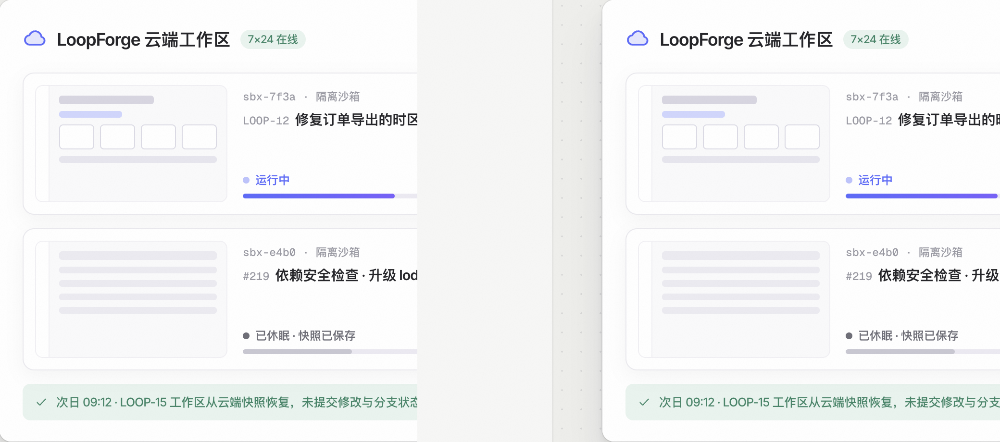
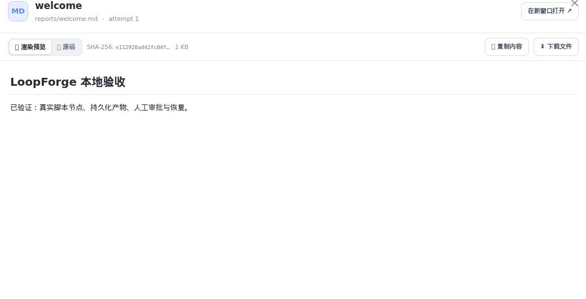

# 7×24 云端沙箱与产物抽屉

> **日常工作区 · 03** · 在 LoopForge 中，AI 写代码、跑脚本都在独立的 Docker 云端沙箱里完成，不会弄乱你的电脑；生成的所有文档和报告都能在右侧抽屉一键预览。

## 什么是「对话工作区（云端沙箱）」？

在普通聊天软件里，AI 只能给你贴一段代码让你自己复制回去运行；而在 LoopForge 中：

1. **按需自动开启**：当你和 Main Bot 只是普通问答时，它秒级响应；一旦你的需求涉及「生成项目文件、修改代码仓库、运行测试命令」，Main Bot 会自动在后台为你开启一个隔离的 **Docker 云端沙箱工作区**。
2. **合上电脑照常运行**：沙箱运行在服务端。哪怕任务需要跑 20 分钟测试，你直接关掉浏览器或合上笔记本电脑下班，云端任务也会继续跑完。
3. **自动休眠与快照恢复**：工作区闲置时会自动保存完整快照并释放计算资源；第二天你重新打开同一个对话继续说话时，系统会自动从快照恢复代码分支与未提交的修改，现场分毫不差。

---

## 在右侧「产物抽屉」预览与下载成果

无论你是让 AI 写了一份产品需求文档（PRD）、测试报告，还是生成了一套前端页面，都不需要懂怎么进服务器找文件：

* **一键打开产物抽屉**：点击对话消息中的文件卡片，或点击工作台右上角的产物按钮，右侧会滑出宽敞的 **产物抽屉（默认宽 440px，支持拖动分隔条调整宽度）**。
* **渲染预览 vs 源码切换**：
  * 对于 Markdown 文档（`.md`），默认以排版精美的 **「渲染预览」** 模式展示标题、表格和列表，也支持切换到 **「源码」** 查看原始文本。
  * 顶部工具栏提供 **「复制内容」**、**「下载文件」** 和 **「在新窗口打开」** 按钮，并展示该文件快照的 SHA-256 指纹与文件大小。

---

## 在对话里直接控制正在跑的 SOP（暂停 / 恢复 / 接管）

如果某个需求正在跑一条长长的 SOP 流水线，而你突然发现需求有变动，可以直接在 AI 工作台对话里让 Main Bot 帮你操控那条正在运行的 SOP：

| 控制动作 | 对 Main Bot 怎么说 / 怎么用？ | 实际效果 |
| --- | --- | --- |
| **暂停（Pause）** | 告诉 Main Bot「先暂停当前运行」，或在运行页点「暂停」。 | 流水线在当前节点停下，你可以让 Main Bot 或自己在工作区里微调代码或补充文件。 |
| **恢复（Resume）** | 修改完成后，让 Main Bot「带着刚才的改动说明继续运行 SOP」。 | 系统把你的修改说明自动注入后续节点，接着跑完剩下的测试与交付步骤。 |
| **接管（Takeover）** | 当觉得固定流程不适合当前特殊情况时，选择「接管」。 | 取消原定 SOP 的后续机械步骤，直接保留当前已经做完的工作区现场，转为在对话里由 Main Bot 自由修改并直接提交 PR。 |

> **给进阶用户的环境选择开关**：默认情况下，Main Bot 会自动挑选最合适的沙箱环境。如果你需要手动指定某套特定 Docker 沙箱，可以点击输入框左下角的 **`＋` → `高级设置` → 开启 `显示运行环境选择`**，即可在项目选择器旁边直接切换沙箱环境。

---

← 上一篇：[输入框工具栏与权限模式](02-toolbar-and-permissions.md) | [返回文档总目录](../README.md) | 下一篇：[需求列表与看板管理](04-requirements-and-board.md) →
