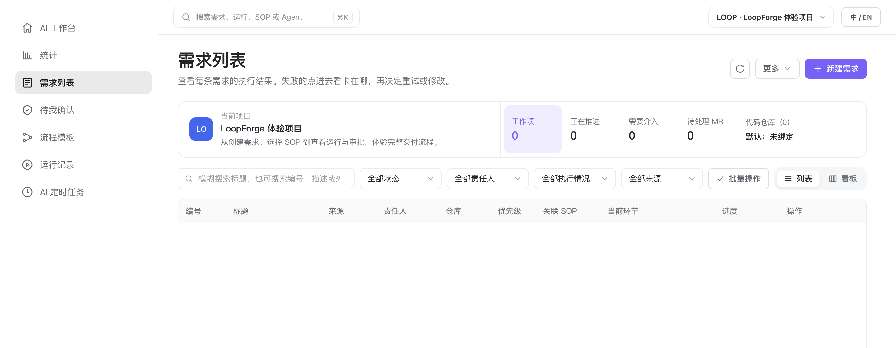
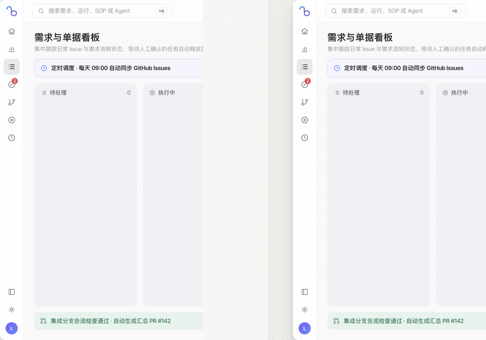

# 需求列表与看板管理

> **日常工作区 · 04** · 所有的任务单、缺陷修复和对话改代码记录都会汇总在「需求列表」中。你可以用列表或拖拽看板掌控全局进度。

## 页面顶部的 5 个核心健康指标

点击左侧图标栏第 3 个图标进入 **「需求列表」**。页面上方的项目概览卡片一眼展示了当前项目的交付健康度：

1. **工作项**：当前项目下的总需求 / Issue 数量。
2. **推进中**：正在由 SOP 流水线或对话工作区积极处理中的任务数。
3. **需介入**：遇到人工审批关口、门禁校验失败、运行报错或待确认澄清结论的任务数——**这是你每天最该优先看一眼的数字**。
4. **待合入 MR**：代码已经改完并提交了 Pull Request / Merge Request，正在等待合入主干分支的数量。
5. **代码仓库**：显示当前项目绑定的默认 GitHub 代码仓库状态。

---

## 两种创建需求的方式

在页面右上角，你可以通过两种方式把工作项放进项目：

* **方式一：点击「＋ 新建需求」（本平台直接创建）**
  * 填写需求标题、Markdown 说明、优先级（`Urgent 紧急` / `High 高` / `Medium 中` / `Low 低`）与责任人。
  * 如果你选好了关联的 SOP 流程与目标仓库，创建后即可直接派发给 AI 自动执行。
* **方式二：从 GitHub 同步 / 在对话中自动登记**
  * 绑定了 GitHub 仓库的项目支持把远端的 GitHub Issues 同步进来。
  * 此外，当你在「AI 工作台」对话里直接让 Main Bot 修改代码并提交 PR 时，系统也会**自动为你补建一条关联需求**（标记为 `对话工作区`），确保没有任何一次代码改动脱离台账管理。

---

## 列表视图与看板视图切换

在筛选工具栏右侧，你可以随时切换两种视图模式：

* **列表视图**：以表格形式清晰展示每条需求的 `编号`、`标题`、`来源`、`责任人`、`仓库`、`优先级`、`关联 SOP`、`当前环节`、`进度` 与 `操作`。
* **看板视图（Kanban）**：按流转状态分列展示卡片（如 `待处理`、`执行中`、`待我确认`、`已完成`），支持直观查看各阶段的拥堵情况与拖拽流转。

---

## 点击任意一行：右侧需求详情抽屉（7 大标签页）

点击表格中的任意一条需求，右侧会滑出渐进式的 **需求详情抽屉**。上面的一排标签页把这件事的前因后果整理得井井有条：

| 详情标签页 | 里面能看到什么？ | 什么时候点开看？ |
| --- | --- | --- |
| **概览** | 需求的原始描述、优先级、责任人、来源与基础状态。 | 想确认这条任务最初是怎么提的。 |
| **执行进展** | 当前关联 SOP 的节点进度条；如果是对话直接改代码，则展示检出的分支与 MR 状态。 | **任务失败或卡住时，第一时间看这里。** |
| **产物** | 这条需求在各个阶段产出的全部文档、报告和代码补丁，带 SHA-256 校验留痕。 | 想直接阅读方案文档或验收测试报告。 |
| **会话** | 围绕这条需求进行过的讨论会话记录，点击「打开会话」可跳回聊天现场。 | 想回顾当时为什么决定这么改。 |
| **澄清** | AI 在动手前梳理出的疑问点与最终确认的澄清结论。 | 检查 AI 有没有曲解需求原意。 |
| **代码交付** | 自动发起的 GitHub PR / MR 链接、目标分支与合入状态。 | 查看最终提交给代码库的改动。 |
| **验收 / 活动 / 操作日志** | 人工验收结论、状态流转时间线与每一次重试/审批的审计记录。 | 复盘责任人与历史操作时间点。 |

---

← 上一篇：[7×24 云端沙箱与产物抽屉](03-cloud-workspace-and-artifacts.md) | [返回文档总目录](../README.md) | 下一篇：[待我确认（人工审批门禁）](05-human-approvals.md) →
