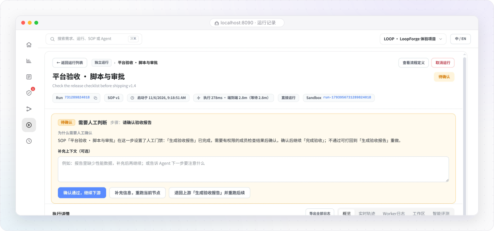

# 待我确认（人工审批门禁）

> **日常工作区 · 05** · LoopForge 坚持「关键节点由人把关」。当任何一条自动化流程跑到人工审批节点时，都会停在「待我确认」等你做出决定。

## 什么是「人工审批门禁（Human Gate）」？

在团队协作中，你既希望 AI 自动干完繁琐的分析、写代码和跑测试，又不希望它在没经过你同意的情况下乱改方案或直接合入代码。

为此，SOP 流程里可以设置一个或多个 **人工关口（Human Gate）**。每当流程运行到这类节点时：

* 引擎会立即暂停往下推进，并释放占用的计算算力（不会白白消耗资源）。
* 左侧图标栏第 4 个盾牌对勾图标 **「待我确认」** 右上角会亮起醒目的红色数字角标。
* 如果当前没有任何需要审批的事项，页面会显示清爽的绿色对勾：**「没有需要你拍板的需求」**。

---

## 审批时你能看到的完整依据

当你点进「待我确认」列表，或者在运行详情页看到黄色的 **「需要人工判断」** 面板时，系统绝不会让你盲目做决定，而是会把前序步骤的所有证据摆在你面前：

1. **当前停在哪个步骤**：例如 `请确认验收报告`、`方案评审` 或 `人工验收`。
2. **上游节点产出的交付物**：你可以直接点击打开上游刚刚生成的 `requirement.md`（需求定型）、`design.md`（技术方案）或 `test-report.md`（测试报告），先看成果再表态。
3. **补充上下文输入框（可选）**：无论你是批准通过还是退回重做，都可以在文本框里写下你的具体批注或补充要求，这段话会原封不动地注入给后续干活的 AI 角色。

---

## 三种拍板决策：点哪一个会发生什么？

在审批面板底部，你有三种明确的决策按钮可选：

| 按钮名称 | 英文界面名称 | 点击后的实际效果 | 典型使用场景 |
| --- | --- | --- | --- |
| **确认通过，继续下游** | `Approve and continue` | 当前人工关口标记为通过，引擎立即唤醒后续节点继续往下执行（如果你填了批注，下游节点会收到这段指导）。 | 方案或测试报告检查无误，同意继续开发或正式交付。 |
| **补充信息，重跑当前节点** | `Add context and rerun this step` | 在「补充上下文」里写明遗漏的背景信息后点击，让当前节点结合你的新信息重新执行一次。 | 发现当前步骤缺了一点上下文，只需微调重跑本步。 |
| **退回上游「XXX」并重跑后续** | `Send back to "…" and rerun downstream` | 直接把流程打回到前面指定的某个节点（例如从「人工验收」打回到「开发实现」或「方案设计」），要求 AI 按你的批注返工重做，然后再重新走一遍测试与审批。 | 发现方案方向偏了、或者功能效果不符合预期，需要推倒返工。 |

> **安心提示**：如果你点开审批卡片后暂时拿不准主意，**什么都不用点，直接关掉页面即可**。任务会安全地停留在原处等你，既不会超时报错，也不会偷偷往下改代码。

---

← 上一篇：[需求列表与看板管理](04-requirements-and-board.md) | [返回文档总目录](../README.md) | 下一篇：[运行记录、在线工作区与 AI 评测](06-runs-and-evaluation.md) →
