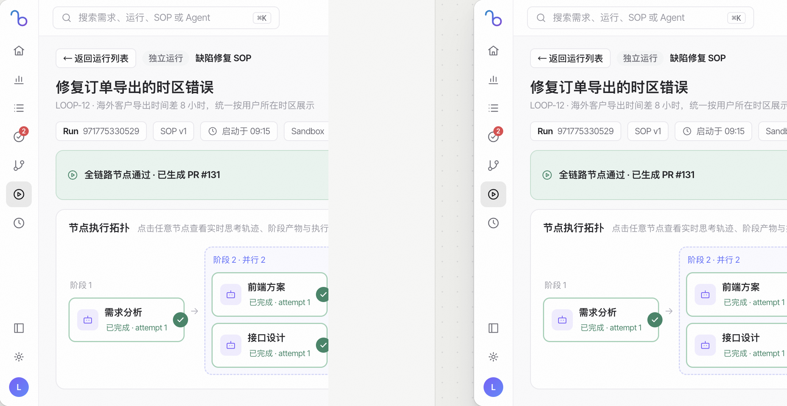
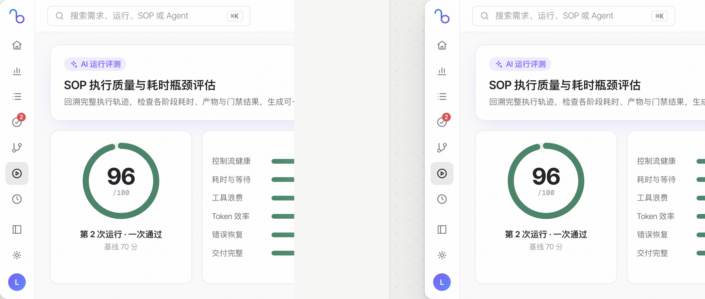

# 运行记录、在线工作区与 AI 评测

> **日常工作区 · 06** · 每一条启动过的 SOP 流程都会在「运行记录」中留下完整档案。你可以查看节点拓扑、在内置 VS Code 工作区浏览代码、体验前端预览，或发起 0–100 分 AI 智能评测。

## 运行详情页顶栏与核心元信息

点击左侧图标栏第 6 个播放键图标进入 **「运行记录」**，点开任意一条运行即可进入详情页：

1. **顶部元信息与快捷操作**
   * 显示唯一运行编号（点击 `Run ID` 旁的复制图标可一键复制完整 ID）、遵循的 `SOP 版本号`、启动时间、**实际执行耗时**（仅统计真实执行时间，自动扣除人工审批等待时间）以及沙箱 ID。
   * 右上角提供常用跳转与控制按钮：**「打开需求」**（滑出关联的需求详情抽屉）、**「查看流程定义」**（跳到流程设计器画布）、**「暂停运行」**、**「取消运行 / 删除记录」**。
2. **项目并发名额与排队说明**
   * 每个项目最多同时运行 **10 条顶层 SOP**（嵌套的子 SOP 共享父级名额）。超出名额的新运行会自动进入 **「排队中」** 状态，等前序任务释放名额后自动启动。

---

## 执行详情的 6 大功能标签页

在运行详情页中部的 **「执行详情」** 右侧，提供了一排强大的视图切换标签（旁边的 **「导出全部日志」** 按钮可一键把所有节点的 Worker 日志下载为 `.txt` 文件）：

| 标签页名称 | 里面能看到什么、能做什么？ |
| --- | --- |
| **1. 概览（Overview）** | • **三大指标卡片**：执行进度（已完成节点数与百分比）、实时资源消耗（输入/输出 Token、缓存命中率、折算美元成本与工具调用次数）、交付物（不可变快照总数）。 • **节点执行拓扑图**：按阶段列展示串行与并行节点（含阶段起止时间与上游依赖）；若包含子 SOP 节点，支持一键 **「打开子 SOP 运行」**。 • **节点检查器与节点交付物**：点击拓扑图上的任意节点，下方立即展示该节点的尝试次数、返工次数、结构化输出、门禁结果，以及该节点产出的全部文件卡片（点击即可渲染预览或下载）。 |
| **2. 实时轨迹（Trace）** | 实时滚动展示当前选中节点的 Agent 思考过程、工具调用参数与返回结果摘要，支持加载更早的历史轨迹。 |
| **3. Worker 日志（Logs）** | 按时间顺序展示沙箱底层与 CLI 的原始标准输出日志，方便排查构建或环境报错。 |
| **4. 工作区（Workspace）** | 直接在浏览器页面内嵌打开 **网页版 VS Code 编辑器**！无需把代码拉回本地，就能在线浏览当前运行沙箱里的完整目录树、查看代码改动，并支持 **全屏放大** 或 **弹出独立窗口**（运行完成且工作区按策略清理后，历史日志与交付物快照依然保留可看）。 |
| **5. 前端预览（Preview）** | 当 SOP 流程包含「预览构建」节点时自动出现。构建归档完成后，可直接在页面内交互体验生成的前端网页，还支持 **设置/更改预览后端 API 地址**、**下载完整静态站点 ZIP 包**、**复制预览地址** 或在 **独立窗口打开**。 |
| **6. 智能评测（Eval）** | 运行结束后，用大模型对整条全链路 Trace 做 0–100 分深度复盘，并一键把优化补丁写回 SOP（详见下方说明）。 |

---

## AI 智能评测（RSI 自动复盘与一键回写补丁）

一条流程跑完后（尤其是中间发生过测试打回返工、或耗时较长时），切换到 **「智能评测」** 标签页并点击 **「启动评测」**：

1. **0–100 分六维体检（默认基线准入分 70 分）**
   * **控制流健康（25%）**：节点是否多次循环、返工或打回？
   * **耗时与等待（20%）**：单节点是否占了大部分执行时间？
   * **工具浪费（20%）**：是否有同一工具连续失败或空转调用？
   * **Token 效率（15%）**：Token 是否异常集中在单一节点？
   * **错误恢复（10%）**：相同错误是否反复出现？
   * **交付完整（10%）**：终态、产物和验证信号是否齐全？
2. **改进建议「一键回写 SOP 补丁」**
   * 评测会自动生成可落地的优化处方（如调整节点打回目标与重试上限、向角色追加防踩坑指令、新增或更新验证门禁）。
   * 点击建议右侧的 **「一键应用」**，系统会直接为 SOP 或角色生成新版本，且不会破坏本次历史运行的冻结快照。

---

← 上一篇：[待我确认（人工审批门禁）](05-human-approvals.md) | [返回文档总目录](../README.md) | 下一篇：[SOP 暂停介入、局部重跑与恢复](07-run-recovery-and-rerun.md) →
