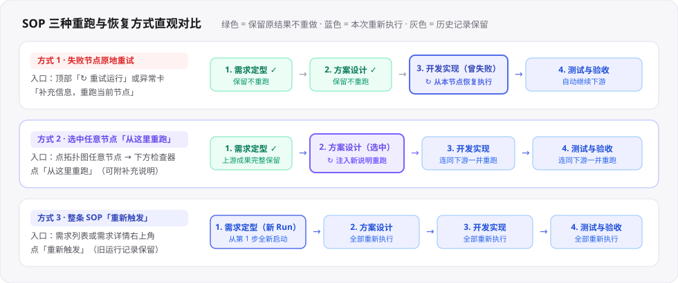
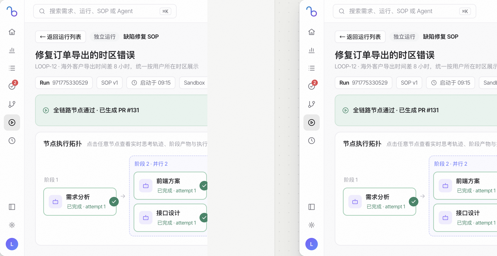

# SOP 暂停介入、局部重跑与故障恢复

> **日常工作区 · 07** · 任务跑偏了想中途插手？某个节点失败了不想从头重来？刚刚改了 SOP 画布想直接用上？一文搞懂 LoopForge 的 5 种运行控制与重跑机制。

## 三种「重试 / 重跑」怎么选？（新手必看对比）

当一条 SOP 运行报错、或者你对某一步的结果不满意时，不需要每次都把整条流水线推倒重来。平台提供了三种不同粒度的重跑方式：

| 操作名称 | 在哪里点击？ | 它会重跑哪些步骤？ | 什么时候用它？ |
| --- | --- | --- | --- |
| **1. 失败重试 / 补充信息重跑当前节点** | 运行详情页顶部的 **「↻ 重试运行」**，或黄色/红色异常面板里的 **「补充信息，重跑当前节点」** | **只从当前失败或暂停的节点开始恢复执行**，前面已经成功的上游节点全部保留不重做。 | 某个节点因为刚配好 API Key、网络抖动或少了一句背景说明而失败，想接着往下跑。 |
| **2. 从这里重跑（局部定点重跑）** | 点击拓扑图上的任意节点，在下方节点检查器里点 **「从这里重跑」**（或在需求详情抽屉的节点行右侧点 **「从这里重跑」**） | **保留该节点之前所有已完成的上游结果**，仅从你选中的这个节点开始，连同它的所有下游节点重新跑一遍。 | 流程虽然跑完了，但你觉得中间某一步（比如「页面实现」或「方案设计」）做得不够好，想补几句要求从这一步往后重做，保留更早的「需求定型」成果。 |
| **3. 重新触发（整条从头新开）** | 在「需求列表」操作列或「需求详情抽屉」右上角点击 **「重新触发」** | **整条 SOP 从第 1 步开始全新跑一遍**（生成一条新的 `Run ID`，之前的旧运行记录完整保留供对比）。 | 需求描述大改了、或者上一次运行已经被手动取消且工作区已清理，需要彻头彻尾重跑一次。 |

---

## 详解 1：节点失败时的两种恢复动作（重试 vs 手动通过脚本）

当某个节点执行失败时，运行详情页上方会弹出红色的 **「执行异常 · 节点已失败」** 诊断卡片，清楚列出失败原因、Agent 终态（例如 `Agent 认为任务已完成，但节点客观校验未通过`）与失败证据：

* **如果是 AI Agent 节点失败**：
  * 如果是因为缺少 API Key 或 Git Token，卡片内会直接提供快捷配置入口；配好凭证后点击 **「补充信息，重跑当前节点」**（可附上补充指导说明）即可原地恢复。
* **如果是脚本节点（Script）失败**：
  * 除了点击 **「重试」** 重新跑一遍脚本外，如果某个硬编码检查脚本受环境限制一直卡住、而你确认产物其实没问题，可以点击旁边的 **「手动通过，继续下游」**——系统会将该脚本节点直接标记为人工放行，继续启动下游节点。

---

## 详解 2：在任意节点点击「从这里重跑」

无论当前运行是处于「已完成」「失败」还是「待确认」状态，只要某个节点的上游依赖都已经完成：

1. 在运行详情页的 **「节点执行拓扑」** 中点击你想重做的那个节点（或者打开需求详情抽屉的「执行进展」页签）。
2. 点击 **「从这里重跑」** 按钮。
3. 在弹出的确认框中（非脚本节点会提供一个 **补充说明输入框**），写下你希望它这次怎么改进（例如：`把导出格式从 JSON 改成带表头的 CSV`），点击 **「开始重跑」**。
4. **工作区自动恢复机制**：如果该运行的工作区此前已被定时清理，系统会优先从已保存的快照恢复；没有快照时会自动重新检出仓库并注入已归档的上游节点产物，确保重跑顺利衔接。

---

## 详解 3：运行中随时「暂停 → 在线改代码 → 直接继续」

当你看到一条 SOP 正在跑，突然想自己进去改两行代码，或者给 Agent 补一句提示：

1. **点击「暂停运行」**：在运行详情页右上角点击 **「暂停运行」**，流水线会在当前步骤安全停下，弹出「流程已暂停执行」面板。
2. **在线查看或修改文件**：切换到 **「工作区」** 标签页，直接在内嵌的 VS Code 编辑器里修改文件并保存（也可以在 AI 工作台对话里让 Main Bot 帮你改）。
3. **点击「直接继续」**：回到概览页，在暂停面板的文本框里写下你的修改说明，点击 **「直接继续」**。Agent 会优先接续原有的 CLI 会话，带着你的改动继续跑完后续节点。

---

## 详解 4：热升级「更新为最新 SOP」与「轮次耗尽续跑」

* **更新为最新 SOP（`更新为最新 SOP (vX #Y)`）**
  * 默认情况下，正在跑或已暂停的运行使用的是启动那一刻的冻结快照。
  * 如果你在运行暂停或失败期间，去「流程设计」画布里修改并保存了这条 SOP（比如调高了重试上限、或改了下游节点配置），回到运行详情页右上角就会看到 **「更新为最新 SOP」** 按钮。点一下它，就能把当前运行切换到最新流程定义，然后接着重跑节点，无需从头重开一条新运行！
* **对话轮次已用尽（`重试本节点` / `不重试`）**
  * 当某个复杂节点因为单次最大对话轮次耗尽而暂停时，审批框会显示 **「对话轮次已用尽」**。点击 **「重试本节点」** 即可继续给它分配轮次往下做；点击 **「不重试」** 则将该节点标为失败并停止流程。

---

← 上一篇：[运行记录、在线工作区与 AI 评测](06-runs-and-evaluation.md) | [返回文档总目录](../README.md) | 下一篇：[SOP 流程模板：选用与复制](../03-automation/01-sop-templates.md) →
