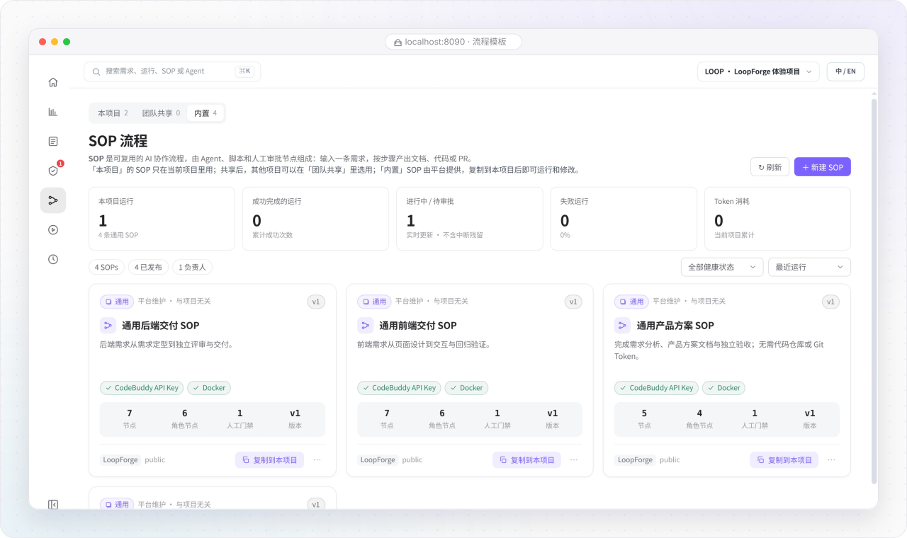

# SOP 流程模板：选用与复制

> **流程与自动化 · 01** · SOP（标准作业流程）是把团队最佳交付经验固化下来的流水线蓝图。你可以直接复制平台内置的 4 条成熟模板，零基础起步。

## 流程模板页的三个范围标签

点击左侧图标栏第 5 个分支节点图标进入 **「流程模板」**（页面标题为 **SOP 流程**）。你会看到页面上方分为三个范围标签：

| 范围标签 | 英文界面名称 | 里面的 SOP 是从哪来的？ | 你能对它做什么？ |
| --- | --- | --- | --- |
| **本项目** | `This project` | 归属于当前正在查看的项目的专属流程（例如体验项目里自带的「平台验收 · 脚本与审批」）。 | 可以直接点击 **运行**、进入画布 **编辑修改**，或者将它 **发布共享** 给团队里的其他项目。 |
| **团队共享** | `Team shared` | 同一台平台上，其他项目主动共享出来的优秀流程模板。 | 可以查看它的步骤结构，或点击 **复制到本项目** 后作为你们项目的流程使用。 |
| **内置** | `Built-in` | 平台官方维护的 4 条标准化只读蓝图，与具体项目无关，所有项目都能随时取用。 | 内置模板本身是只读保护的；点击卡片上的 **「复制到本项目」** 后，就会进入「本项目」列表，即可自由运行和按需修改。 |

---

## 平台内置的 4 条标准 SOP 蓝图详解

如果你刚新建了一个项目，不知道怎么从零画流程，直接切换到 **「内置」** 标签页，从下面 4 条成熟蓝图中挑一条复制到本项目即可：

| 内置 SOP 名称 | 适用场景 | 典型流水线阶段 | 是否必须绑定 GitHub 仓库？ |
| --- | --- | --- | --- |
| **通用产品方案** | 从一句话想法产出完整的产品需求文档（PRD）、交互方案与评审定稿。 | 需求澄清 → 方案设计 → 独立评审 → 人工确认定稿 | **不需要**（纯文档产物，直接在工作区预览下载） |
| **通用前端交付** | 新建前端页面或组件、还原设计稿、执行前端构建校验并预览页面效果。 | 需求定型 → 前端方案 → 页面实现 → 构建与预览 → 人工验收 | **可选**（新项目可在沙箱内直接交付源码与预览；改已有仓库则绑定 GitHub） |
| **通用后端交付** | 开发后端 API 接口、数据库逻辑，执行编译与单元测试门禁并提交代码。 | 需求定型 → 接口与架构设计 → 开发实现 → 独立评审 → 单测门禁 → 人工验收 | **可选**（同上，支持沙箱内新建或已有仓库提 PR） |
| **通用缺陷修复** | 定位并修复线上或测试发现的 Bug，强制经过复现、修复、独立审查与回归测试。 | 问题复现与定位 → 修复方案 → 代码修复 → 独立评审 → 回归测试 → 人工验收 → 交付汇总 | 需提供待修代码仓库或复现材料 |

---

## 如何把内置模板变成你们项目的流程？（3 步搞定）

1. 在 **「流程模板」** 页面点击顶部的 **「内置」** 标签。
2. 找到你想用的模板卡片（例如 **「通用产品方案」** 或 **「通用缺陷修复」**），点击卡片上的 **「复制到本项目」**。
3. 切回 **「本项目」** 标签，就能看到刚刚复制过来的流程了！你可以直接用它来派发需求，也可以点击它进入 **「流程设计」** 画布微调步骤。

> **小贴士**：在流程模板卡片或流程设计页标题旁，都有一枚小巧的 **复制按钮**，点一下就能把该 SOP 的标准名称复制到剪贴板，方便你在聊天框里精确提及它。

---

← 上一篇：[SOP 暂停介入、局部重跑与恢复](../02-workspace/07-run-recovery-and-rerun.md) | [返回文档总目录](../README.md) | 下一篇：[流程设计器：画布编排与门禁](02-flow-designer.md) →
