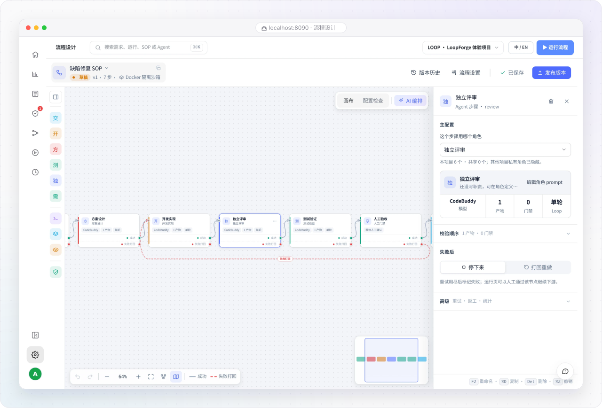
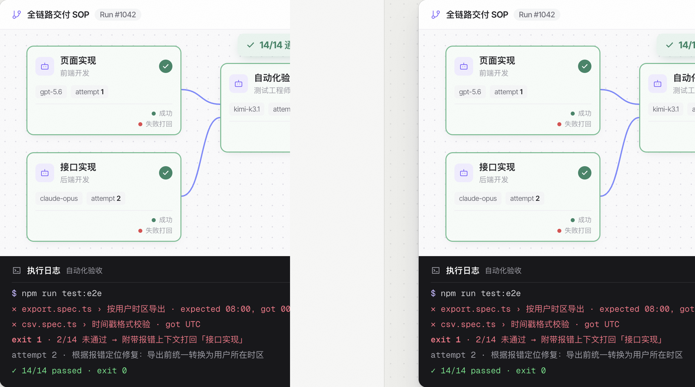

# 流程设计器：画布编排与门禁

> **流程与自动化 · 02** · 点击任意一条本项目的 SOP 即可进入可视化「流程设计」画布。通过拖拽 5 类节点、设置退出码门禁与失败打回连线，像搭积木一样定义工程标准。

## 认识流程设计器画布

当你从「流程模板」点进某一条流程（或在 **「设置 → 流程设计」** 中打开）时，会看到左、中、右三栏结构的可视化设计器：

* **左侧组件面板（流程步骤）**：上方提供可拖拽到画布上的节点积木，下方按执行顺序列出当前 SOP 的所有步骤清单。
* **中间可视化画布**：用实线箭头表示「成功后进入下一步（支持多分支并行 DAG 调度）」，用红色虚线箭头表示「校验或审批不通过时打回哪一步返工」。
* **右侧属性检查器**：当你点击画布上的任意一个节点时，右侧面板会展示该节点的名称、绑定角色、执行器、必交产物、客观验证门禁与失败重试策略。

---

## 画布上的 5 种节点类型

一条 SOP 并不是所有步骤都让 AI 瞎猜，而是把 AI、确定性脚本和人类把关组合在一起：

| 节点类型 | 图标特征 | 它是干什么的？ | 什么时候用它？ |
| --- | --- | --- | --- |
| **Agent 节点** | 机器人图标 | 指派一个具体的 **角色（Role）** 来完成分析、设计、写代码或独立评审，并要求它交出指定文件（如 `design.md`）。 | 需要理解需求、撰写文档、编写代码、做代码审查的创造性环节。 |
| **脚本节点（Script）** | 代码尖括号 `<>` | 执行确定性的 Shell 命令（如 `go test ./...`、`npm run build`、运行 Lint 或生成固定报表）。**不需要 AI 的地方就不用 AI。** | 编译构建、运行单元测试、格式化检查、生成固定格式验收报告。 |
| **人工门禁（Human Gate）** | 盾牌图标（虚线框） | 运行到这里时自动暂停流水线，在 **「待我确认」** 中等待有权限的成员检查产物后批准放行或打回。 | 方案定稿签字、上线前最终验收、高风险操作确认。 |
| **子 SOP（Sub-SOP）** | 分支流程图图标 | 在当前大流程里嵌套调用另一条已经定义好的 SOP 作为子阶段。 | 复用公共的测试流程或发布流程。 |
| **预览构建（Preview）** | 窗口预览图标 | 构建前端静态站点并生成归档预览链接，方便产品和设计直接在浏览器里点开看真实界面效果。 | 前端页面开发完成后的视觉走查与交互验收。 |

---

## 核心机制：客观质量门禁与「失败自动打回」

为什么 LoopForge 的 SOP 比普通 AI 对话更可靠？秘密在于右侧检查器里的两项配置：

1. **按命令退出码客观判定，不听 AI 口头邀功**
   * 在普通聊天里，Agent 经常会说「我已经改好并通过测试了」，但其实连编译都没跑。
   * 在 SOP 节点中，你可以配置客观门禁命令（例如要求必须生成 `test-report.md`，且测试命令返回 `exit 0`）。只要命令返回非 0，系统就判定门禁未通过。
2. **附带报错日志自动打回重做（Reject Edge）**
   * 当门禁未通过或人工点击「退回」时，流程会沿着红色虚线打回到你指定的上游节点（如打回 `开发实现`），并**自动把刚才的失败报错日志一起塞给上游节点**。
   * 在你设定的重试上限（如最多重试 3 次）内，AI 会根据真实报错当场修复代码并重跑门禁，实现无人值守的「门禁自愈」。

---

## 版本发布与「冻结快照」保护

* **角色与画布解耦**：在画布上，Agent 节点只负责**挑选**用哪个角色，而不在画布上直接涂改角色的提示词和技能（修改角色请去「设置 → 角色定义」）。
* **运行使用冻结快照**：当你修改了画布并点击右上角的 **「保存 / 发布版本」** 时，只会对**以后新启动的运行**生效。当前已经在跑或正停在人工审批中的历史运行，使用的是它启动那一刻的冻结快照，绝不会被你的中途修改搞乱。

---

← 上一篇：[SOP 流程模板：选用与复制](01-sop-templates.md) | [返回文档总目录](../README.md) | 下一篇：[AI 定时任务与共享市场](03-scheduled-tasks.md) →
