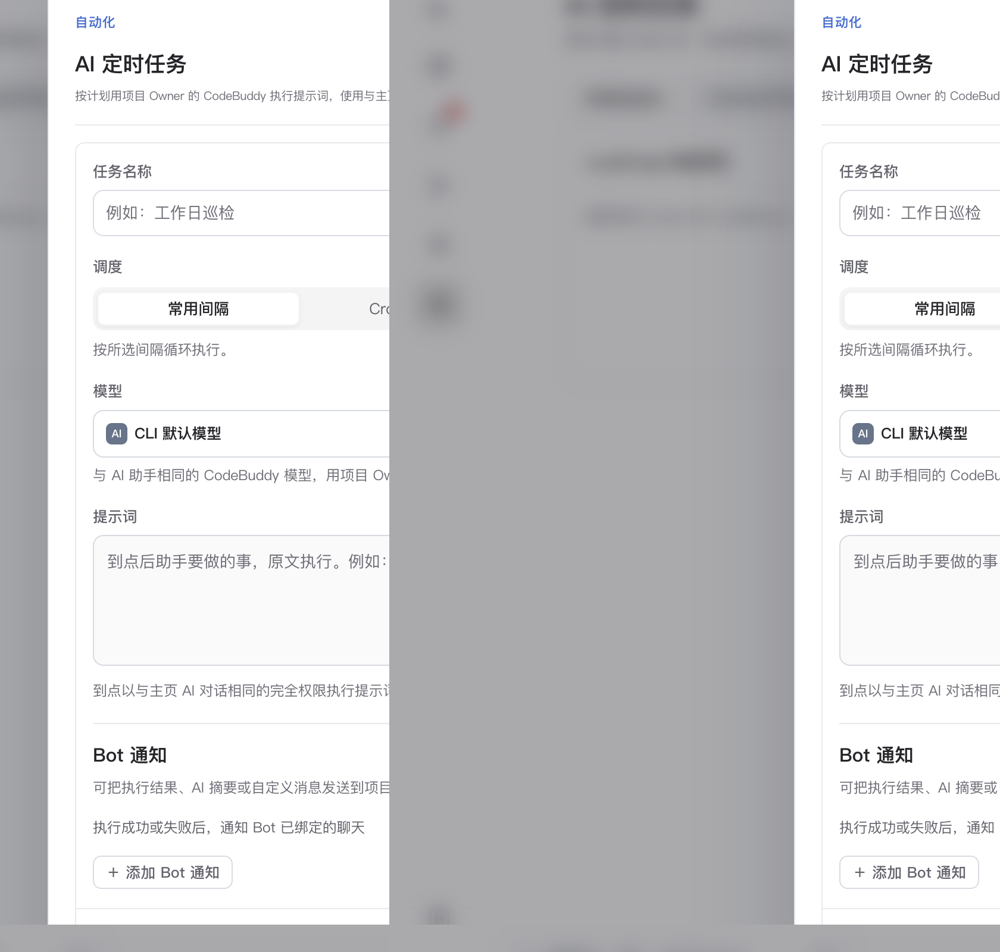

# AI 定时任务与共享市场

> **流程与自动化 · 03** · 把每天重复的巡检、需求整理、日报汇总或 GitHub Issues 自动修复交给「AI 定时任务」，到点自动在云端唤醒执行。

## 什么是「AI 定时任务」？

点击左侧图标栏第 7 个时钟图标进入 **「AI 定时任务」**。

如果说「AI 工作台」是你主动找 AI 说话，那么「AI 定时任务」就是你定好闹钟和指令，让 AI **按计划在后台自动开工**——即使当时没有任何人打开浏览器，服务端也会准时唤醒沙箱完成任务。

---

## 定时任务能帮你做哪些事？

在 LoopForge 中，AI 定时任务拥有与主页「完全权限」一致的完整工作区、SOP 派发与 MCP 工具能力。常见用法包括：

1. **每日/每周项目巡检与进展汇总**
   * 例如设定每天早上 `09:00` 自动运行提示词：「检查当前项目过去 24 小时内失败或卡住的运行，按优先级整理成一份简报，并通过企微 Bot 发送到研发群。」
2. **定时同步 GitHub Issues 并自动派发修复 SOP**
   * 定时扫描绑定的 GitHub 仓库，把新提的日常 Bug 拉取到需求列表，自动匹配「缺陷修复 SOP」在后台沙箱并行修复、运行测试并提交 PR。
3. **定期技术债清理与依赖安全检查**
   * 例如每周五晚上自动检查仓库依赖更新、补充缺失的单元测试或整理文档。

---

## 如何新建一条 AI 定时任务？

1. 在「AI 定时任务」页面右上角点击紫色的 **「＋ 新建 AI 定时任务」** 按钮（仅项目 Owner、平台管理员或具备写权限的项目成员可创建）。
2. 在弹窗中填写：
   * **任务名称与所属项目**：给任务起个清晰的名字（如 `每日早会进展汇总`）。
   * **执行时间计划（Schedule）**：选择每天、每周或自定义定时规则。
   * **执行的提示词（Prompt）或关联 SOP**：用清楚的中文写出到点后要让 AI 做的具体事项与输出格式。
   * **结果通知（可选）**：勾选已配置的 Bot，让任务完成或遇到异常时自动把结果推送到群聊。
3. 点击保存后，你可以随时在列表右侧点击 **「立即运行」** 测试一次效果，无需苦等闹钟到点。

> **凭证说明**：定时任务在后台无人值守运行时，系统会自动使用 **该项目 Owner**（其次为任务创建人）在个人配置里保存的 CodeBuddy 模型 Key 与仓库凭证。

---

## 共享任务市场：直接订阅别人写好的定时任务

在「AI 定时任务」页面顶部，你可以切换 **「本项目任务」** 与 **「共享任务市场」** 两个视图：

* **发布共享**：如果你们项目写了一条特别好用的定时巡检任务，可以在该任务旁点击 **「发布共享」**，把它带版本号和可填参数发布到全站共享市场。
* **一键订阅**：其他项目打开「共享任务市场」后，不用从零写提示词，直接点击订阅并填入自己项目的参数，就能把现成的自动化巡检能力装进自己的项目里。

---

← 上一篇：[流程设计器：画布编排与门禁](02-flow-designer.md) | [返回文档总目录](../README.md) | 下一篇：[个人配置与 GitHub 仓库授权](../04-configuration/01-personal-settings-and-github.md) →
