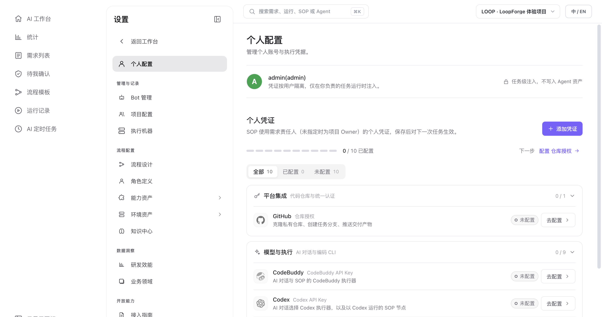

# 个人配置与 GitHub 仓库授权

> **配置与扩展 · 01** · 在「设置 → 个人配置」中集中管理你的个人账号信息、GitHub 代码仓库连接以及各家编码 Agent 的执行凭据。

## 如何进入与离开「设置」区域？

* **进入设置**：点击左侧全局图标栏底部的齿轮图标 **「设置」**，默认打开的就是 **「个人配置」**，同时中间栏会展开完整的设置导航菜单。
* **返回工作台**：点击设置菜单最上方的 **「← 返回工作台」**，或者**再次点击一次左下角的齿轮图标**，就会立即回到「AI 工作台」。

---

## 一键连接 GitHub 仓库（支持设备码免 Token 授权）

如果你希望让 Main Bot 或 SOP 流程直接拉取你们现有的 GitHub 代码仓库、创建分支并自动提交 Pull Request（PR），请在「个人配置 → 平台集成」下配置 **GitHub 仓库授权**：

1. **方式一：点击「连接 GitHub」设备码一键授权（推荐）**
   * 开源版已内置 LoopForge 授权应用，无需你去 GitHub 后台翻找复杂的开发者设置。
   * 点击 **「连接 GitHub」**，根据弹窗提示复制设备码并在浏览器中确认授权，即可勾选允许平台访问的仓库。
2. **方式二：手动填写 GitHub Personal Access Token（PAT）**
   * 如果你们使用的是企业自建环境或希望通过 Fine-grained PAT 精细控制权限，也可以直接在凭证向导中粘贴你的个人访问令牌并保存。

> **什么时候不需要连 GitHub？** 如果你只是用 LoopForge 聊天讨论、写产品方案、或者在云端沙箱里从零生成新项目代码并下载产物，完全不需要连接 GitHub。

---

## 管理 9 大执行器模型凭据

在「个人配置 → 模型与执行」区域，你可以为平台支持的 **9 种主流 Coding Agent 执行器** 分别保存 API Key、Base URL 与接口协议：

| 执行器名称 | CLI 标识 | Base URL 要求 | 接口协议选择 | 凭据说明与注意事项 |
| --- | --- | --- | --- | --- |
| **CodeBuddy**（默认） | `codebuddy` | 按站点选择（`国际站` / `国内站`） | 内置 | 粘贴以 `ck_` 开头的 Key（Key 只能在创建它的站点使用；第三方 `sk-` Key 请勿填在此处）。 |
| **Codex** | `codex` | 选填（留空走 OpenAI 官方地址） | OpenAI Responses | 用于 Codex 对话与 SOP 节点；走代理或私有网关时填写 Base URL。 |
| **Claude Code** | `claude-code` | 选填（留空走 Anthropic 官方地址） | Anthropic Messages | 用于 Claude Code 对话与 SOP 节点；支持自定义网关 Base URL。 |
| **OpenCode** | `opencode` | **必填**（无自带模型服务） | `Chat Completions` / `Responses` / `Messages` | 必须填写模型服务 Base URL 并选择该地址提供的接口协议。 |
| **Cursor CLI** | `cursor` | 无需填写（仅连 Cursor 官方） | 内置 | 在 Cursor 控制台 `Integrations → User API Keys` 创建以 `crsr_` 开头的 Key。 |
| **Antigravity** | `agy` | 选网关时**必填**（Gemini 官方免填） | `Gemini 官方 API` / `OpenAI 兼容网关` | 默认连接 Google AI Studio（Gemini 官方）；切换为 OpenAI 兼容网关时需填写网关 Base URL。 |
| **Kimi Code** | `kimi` | 选填（留空连 `api.moonshot.cn/v1`） | `Chat Completions` / `Responses` / `Messages` | 未填 Base URL 时直连 Moonshot 官方服务，内置 K3.1 / K3 / K2.8 等编程模型。 |
| **Pi** | `pi` | **必填**（无自带模型服务） | `Chat Completions` / `Responses` / `Messages` | 必须填写模型服务 Base URL 并选择对应接口协议。 |
| **DeepSeek Harness** | `dsh` | 选填（留空连 `api.deepseek.com`） | `Chat Completions` / `Responses` / `Messages` | 未填 Base URL 时直连 DeepSeek 官方服务（内置 DeepSeek V4.1 Flash / V4 Pro 等模型）。 |

* **按需配置**：你平时在聊天框或 SOP 角色里选哪个执行器，就配哪一个的 Key（内置角色、需求澄清与定时任务默认使用 `CodeBuddy`）。
* **支持随时更新与删除**：点击已配置的凭证行即可展开修改 Key、Base URL 或协议；清空或删除凭证时会同步清理关联的 Base URL 与协议设置。
* **切换外观主题**：如果你想把界面换成深色模式，点击左下角你的 **圆形头像**，在弹出的卡片「外观」行即可一键切换 **「浅色 / 深色 / 跟随系统」**。

---

← 上一篇：[AI 定时任务与共享市场](../03-automation/03-scheduled-tasks.md) | [返回文档总目录](../README.md) | 下一篇：[项目配置与团队成员权限](02-projects-and-members.md) →
