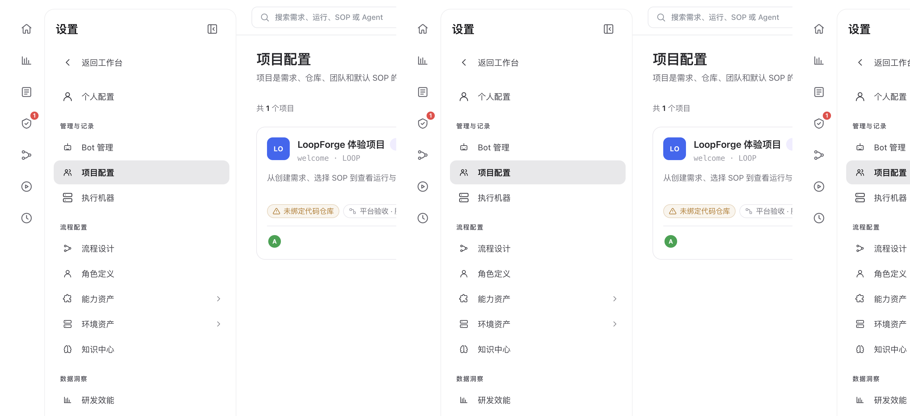

# 项目配置与团队成员权限

> **配置与扩展 · 02** · 在 LoopForge 中，「项目」是需求、代码仓库、团队成员和默认 SOP 的统一边界。通过项目配置，你可以为不同产品线建立清晰的工作空间。

## 什么是「项目」？为什么先用体验项目就够了？

* 在 LoopForge 里，每一条需求、每一次 SOP 运行、每一个绑定的代码仓库都归属于某一个具体的 **项目（Project）**。
* 系统安装好后自带 **`LOOP · LoopForge 体验项目`**。如果你只是想体验对话、写文档或跑测试流程，直接留在体验项目里即可，不需要自己新建项目。
* 当你们团队准备把某个真实的产品或代码库接入 LoopForge 长期协作时，再前往 **「设置 → 项目配置」** 新建专属项目。

---

## 新建与配置项目的 3 个核心步骤

进入 **「设置 → 项目配置」** 后，你会看到当前平台上的项目列表。点击右上角新建项目或点进某个已有项目，可以完成以下配置：

1. **基本信息与项目标识（Key）**
   * 设置项目名称（如 `商城后端服务`）与简短的英文前缀标识（如 `SHOP`）。此后该项目下的需求会自动按 `SHOP-1`、`SHOP-2` 编号。
2. **绑定代码仓库（Repositories）**
   * 将你在 GitHub 上授权过的代码仓库绑定到该项目（支持绑定单个或多个仓库，并指定默认主仓库与默认主分支）。
   * 绑定后，Main Bot 打开对话工作区或 SOP 执行代码修改时，就会自动检出这些仓库的代码。
3. **邀请团队成员并分配角色**
   * 把团队里的产品、设计、测试和研发同事加进项目，他们右上角的项目切换器里就会出现该项目。

---

## 项目成员角色与权限边界

为了防止新成员误删关键流程或改乱配置，项目内区分以下角色权限：

| 成员角色 | 在对话与日常看板中能做什么？ | 在流程、配置与定时任务中能做什么？ |
| --- | --- | --- |
| **项目 Owner / 管理员** | 拥有全部日常对话、提需求、审批与运行权限。 | 可修改项目设置、绑定仓库、管理成员、编辑 SOP 与角色、创建 AI 定时任务（且定时任务默认使用项目 Owner 的模型凭据运行）。 |
| **普通成员（Member）** | 可发起和参与项目共享会话、新建与派发需求、在人工关口审批、查看运行记录与产物。 | 可协同编辑项目内的流程、角色与资产，创建定时任务。 |
| **只读成员（Viewer）** | 可查看项目看板与运行记录，且在已加入的项目会话中同样可以参与对话讨论与查看工作区。 | 不能新建/修改/删除 AI 定时任务，也不能更改项目级核心配置。 |

---

← 上一篇：[个人配置与 GitHub 仓库授权](01-personal-settings-and-github.md) | [返回文档总目录](../README.md) | 下一篇：[执行机器与环境沙箱资产](03-runners-and-environments.md) →
