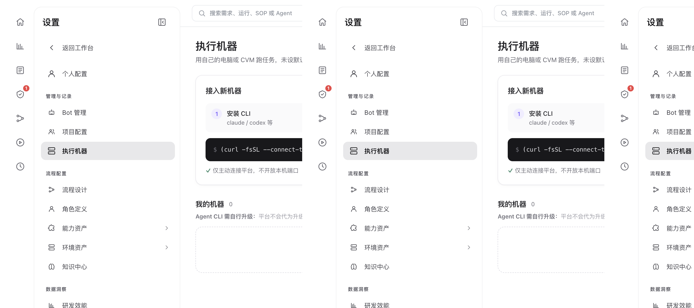

# 执行机器与环境沙箱资产

> **配置与扩展 · 03** · 默认情况下，所有任务都在平台自带的云端 Docker 沙箱里开箱即跑；如果你需要使用本地特定硬件或内网环境，也可以在「执行机器」中接入自己的电脑或服务器。

## 默认云端沙箱 vs 接入自有「执行机器（Runner）」

打开 **「设置 → 执行机器」**，你会看到页面副标题写着：**「用自己的电脑或 CVM 跑任务，未设默认时在云端执行。」**

这两种运行方式怎么选？

| 运行方式 | 需要你额外部署吗？ | 适合什么场景？ |
| --- | --- | --- |
| **平台默认云端环境（推荐）** | **不需要**（保持「我的机器」列表为空或未设默认即可） | 90% 的日常场景。Docker Compose 安装好后，平台直接复用内置的运行镜像启动隔离沙箱容器，无需任何额外配置。 |
| **绑定自有执行机器（Runner）** | 需要（在你的 Mac / Linux 电脑或云主机上运行页面提供的绑定命令） | 需要访问公司内网专有资源、需要使用本机已配好的特殊编译工具链、或希望分担服务端算力压力。 |

### 接入自有执行机器的注意事项

* **自动探测 9 种 CLI**：点击页面上的添加/绑定指引，复制一键绑定命令到你的目标机器终端执行。Runner 启动后会自动探测机器 `PATH`（含 `~/.local/bin`、`~/bin`、`/opt/homebrew/bin`、`/usr/local/bin`）下的 9 个编码 CLI 二进制命令：`codebuddy`、`codex`、`claude`、`opencode`、`cursor-agent`、`agy`、`kimi`、`pi`、`dsh`。
* **凭据隔离与认证方式**：
  * `Claude Code` 与 `Codex` 支持在执行机器卡片上切换使用「本机登录状态」或「平台个人凭证」。
  * `CodeBuddy` 以及 `OpenCode`、`Cursor`、`Antigravity`、`Kimi Code`、`Pi`、`DeepSeek Harness` 在执行任务时，始终在隔离的私有目录中自动注入任务责任人的平台个人凭证，既不需要在机器上手工登录，也不会污染你本机的个人配置。
* **Agent CLI 需自行升级**：页面顶部有醒目提示——如果你使用自己的机器跑任务，请确保机器上安装的编码 CLI（尤其是无 npm 包的 `cursor-agent` 与 `agy`）保持较新版本；版本过旧或无模型权限会导致任务执行失败。

---

## 环境资产（Dockerfile / 环境安装脚本 / 沙箱管理）

在左侧设置菜单中点开 **「环境资产」**，下面包含三个子页面。它们用来决定 AI 干活时的「房间装修标准」：

1. **Dockerfile**
   * 定义构建容器镜像的底层配方（例如需要预装特定版本的 Go、Node.js、Python 或系统依赖库）。
2. **环境安装脚本**
   * 定义进入隔离环境后自动执行的初始化脚本（例如预装某个全局 CLI 工具或配置镜像源）。
3. **沙箱管理（Sandboxes）**
   * 将隔离方式与运行环境组合成一个可选的 **沙箱配置（Sandbox Profile）**，支持三种隔离方式：
     * **`docker（OCI 容器）`**：默认推荐，结合 Dockerfile 在独立容器内隔离运行。
     * **`native（系统轻量隔离）`**：按执行机器的操作系统自动适配（macOS 自动使用 `seatbelt`，Linux 自动使用 `bwrap`），并可将所选环境安装脚本（`install.sh`）的工具装入隔离目录，无需为不同系统维护两套沙箱配置。
     * **`local（本机直接执行）`**：直接在受控的本机工作目录中执行。
   * 在 SOP 流程设置或对话工作区的「高级设置 → 显示运行环境选择」中，可以直接选用这里定义好的沙箱。

> **给新手的定心丸**：以上三个「环境资产」页面是给负责搭建底层环境的研发同学准备的。平台自带的默认 `generic-docker` 沙箱已经能跑通绝大多数常见任务，**平时完全不用改它们**。

---

← 上一篇：[项目配置与团队成员权限](02-projects-and-members.md) | [返回文档总目录](../README.md) | 下一篇：[角色定义（Agents）](04-roles-and-capabilities.md) →
