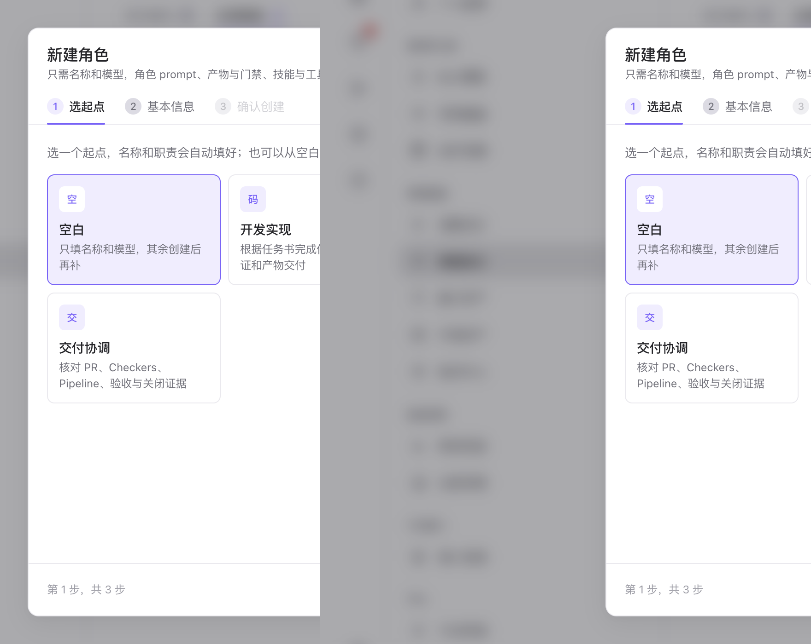

# 角色定义（Agents）

> **配置与扩展 · 04** · 在「设置 → 角色定义」中，把不同岗位的职责、提示词、执行器模型、产物要求和工具权限封装成可复用的专业 AI 角色。

## 什么是「角色（Agent Role）」？

在现实研发团队里，我们不会让同一个人既写需求、又写代码、还自己审批自己的代码。LoopForge 同样采用 **角色分离（Role Separation）** 机制：

* 每一个 **角色** 就代表一个专业岗位，比如 `需求分析师`、`系统架构师`、`前端开发工程师`、`后端开发工程师`、`独立代码评审员`、`测试工程师`。
* 同一个角色定义好之后，既可以在 **SOP 流程画布** 里作为某个步骤的负责人，也可以在 **AI 工作台对话** 中被 Main Bot 作为子 Agent 调用（或者由你用 `@角色名` 直接点名咨询）。

---

## 查看与复用现有角色

进入 **「设置 → 角色定义」** 后，你可以按范围浏览角色卡片：

* **内置与共享角色**：平台已经预置了覆盖产品分析、架构设计、前后端开发、独立评审、测试验证等全套标准角色。你可以直接把它们复制到本项目使用。
* **版本历史与安全回滚**：每个角色的修改都会自动记录版本号（如 `v1`、`v2`）。点击弹窗顶部的 **「版本历史」**，随时可以对比或回滚到之前的稳定版本。

---

## 新建或编辑一个角色的 4 个配置维度

当你点击 **「＋ 新建角色」**（分 3 步向导：`1 选起点 → 2 基本信息 → 3 确认创建`）或点开某个已有角色进行编辑时，配置面板清晰地分为 4 个标签页：

| 配置标签页 | 里面配置什么内容？ | 通俗解释 |
| --- | --- | --- |
| **1. 身份（Identity）** | 角色名称、岗位定位描述、底层 **执行器**（支持全部 9 种 Coding Agent：`CodeBuddy`、`Codex`、`Claude Code`、`OpenCode`、`Cursor`、`Antigravity`、`Kimi Code`、`Pi`、`DeepSeek Harness`）、默认 **模型**（支持从官方目录挑选或输入自定义模型 ID）与 **思考强度**。 | 决定「他是谁、用哪个大脑思考」。比如让擅长写代码的模型当开发，用另一个独立模型当评审。 |
| **2. 任务（Task）** | 角色的核心系统提示词（Prompt）与工作步骤指令。 | 决定「他接手任务后具体怎么干活、遵循什么输出格式」。 |
| **3. 产物与门禁（Gov）** | 必交产物文件路径（如 `design.md`、`review.md`）与客观校验规则。 | 决定「他交出什么文件才算合格交差」，不达标不允许进入下一步。 |
| **4. 技能与工具（Assets）** | 绑定该角色允许使用的 **规则（Rules）**、**技能（Skills）** 与 **MCP 外部工具**。 | 决定「给他配发哪些操作手册和外接工具箱」。 |

---

← 上一篇：[执行机器与环境沙箱资产](03-runners-and-environments.md) | [返回文档总目录](../README.md) | 下一篇：[能力资产：MCP、规则与技能](05-mcp-rules-skills.md) →
