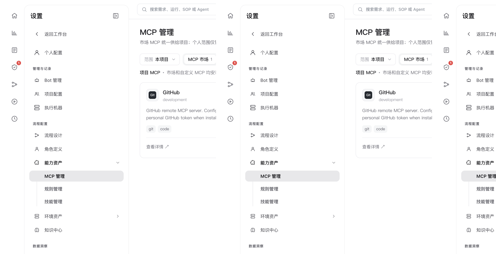

# 能力资产：MCP、规则与技能

> **配置与扩展 · 05** · 在「设置 → 能力资产」下，通过 MCP 管理、规则管理和技能管理，为你的 AI 角色装上外接工具箱、项目红线约定与标准化技能包。

## 能力资产三剑客：它们分别解决什么问题？

在左侧设置菜单中展开 **「能力资产」**，你会看到三个子页面。如果不清楚它们的区别，看下面这张表就一目了然了：

| 能力资产类型 | 一句话比喻 | 它的作用是什么？ |
| --- | --- | --- |
| **MCP 管理** | **外接工具插头** | 让 AI 能够跨出沙箱，安全地调用外部系统的接口（比如查询外部文档库、操作问题追踪系统、调用浏览器或特定业务服务）。 |
| **规则管理（Rules）** | **团队纪律红线** | 写明当前项目必须严格遵守的编码规范、安全禁忌或文档格式要求（例如「所有接口必须包含鉴权校验」「禁止硬编码任何密钥」）。 |
| **技能管理（Skills）** | **专项操作手册** | 把完成某类特定任务的详细步骤、脚本模板和参考文件打包成一个「技能包」。角色绑定该技能后，遇到同类任务就能按手册稳定发挥。 |

---

## 1. MCP 管理：市场一键启用与自定义导入

进入 **「设置 → 能力资产 → MCP 管理」**：

* **市场 MCP vs 个人自定义 MCP**：
  * **市场 MCP** 由平台统一供给项目使用，管理员或项目负责人配置好后，项目内的角色与会话即可直接调用。
  * **个人范围** 仅管理你自己添加的自定义 HTTP / SSE MCP 服务。
* **JSON 快速导入**：如果你手里有一段现成的 MCP Server JSON 配置，可以展开页面上的 JSON 导入面板直接粘贴解析，无需逐个字段手填。

---

## 2. 规则管理（Rules）：给 AI 划定行为边界

进入 **「设置 → 能力资产 → 规则管理」**：

* 你可以创建归属于当前项目的规则，也可以把通用规则共享给其他项目。
* 规则绑定到角色或全局 SOP 后，每次 Agent 执行任务时都会自动把这些约束注入上下文，避免 AI 写出不符合团队规范的代码或文档。

---

## 3. 技能管理（Skills）：安装与绑定现成本事

进入 **「设置 → 能力资产 → 技能管理」**：

* **支持上传或从公开技能库安装**：你可以自己新建技能并上传附加参考文件，也可以从公开技能库安装现成技能（安装时会保存所选版本的快照，保障运行稳定；上游发布新版本时支持手动更新）。
* **怎么让技能生效？** 安装好技能后，前往 **「角色定义 → 技能与工具」** 将该技能勾选绑定到对应角色上，或者在「AI 工作台」聊天框里用 `@技能名` 直接引用它。

---

← 上一篇：[角色定义（Agents）](04-roles-and-capabilities.md) | [返回文档总目录](../README.md) | 下一篇：[Bot 通知与数据看板](06-bots-and-metrics.md) →
