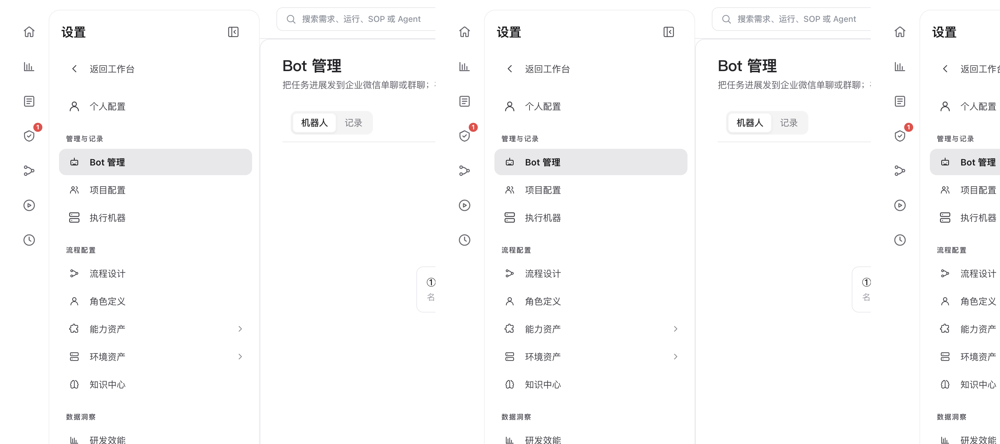
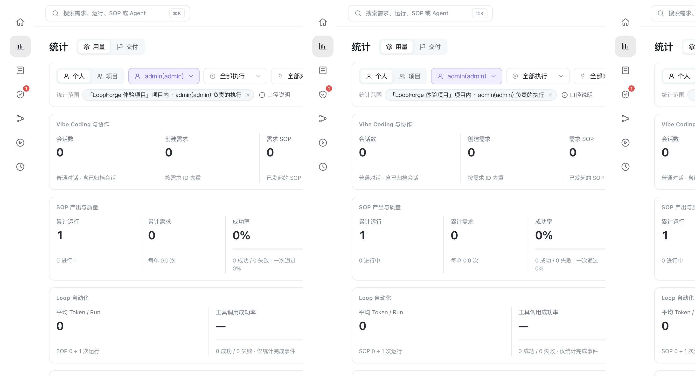

# Bot 通知与数据看板

> **配置与扩展 · 06** · 用「Bot 管理」把任务进展自动推送到企业微信，并通过「统计 / 研发效能 / 业务领域」三大看板看清每一分投入与产出。

## Bot 管理：让任务进展自动发到企业微信

进入 **「设置 → Bot 管理」**（管理与记录下方）：

* **适用场景**：当你启动了一条耗时较长的 SOP 流程，或者配置了每天自动跑的「AI 定时任务」，你不需要一直盯着网页看它跑完没有。
* **三步配置企微机器人**：
  1. 在「Bot 管理」页面点击 **「开始添加」**，填入你在企业微信群聊或单聊中创建的 Webhook 机器人地址与名称。
  2. 在 **SOP 流程设置** 或 **AI 定时任务** 中勾选这个 Bot，并指定触发条件（如 `完成`、`失败`、`需要人工处理`）。
  3. 此后每当任务跑完或停在人工关口等你审批时，你的企业微信就会立即收到一条结构化通知卡片；页面下方的发送记录表还会完整保留每次推送的状态与内容。

---

## 三大数据看板：统计、研发效能与业务领域

LoopForge 内置了三套只读的数据洞察看板，帮助你和团队负责人看清 AI 到底帮大家省了多少时间、花了多少成本：

| 看板名称 | 在哪里打开？ | 核心看什么数据？ |
| --- | --- | --- |
| **统计（Usage）** | 左侧全局图标栏第 2 个图标 | 看当前项目的 **Token 用量与成本核算**（按公开模型标准价分别统计 SOP 运行消耗与日常「Vibe Coding 与协作」对话消耗）、节点耗时与质量评分分布。 |
| **研发效能（Metrics）** | 设置 → 数据洞察 → **研发效能** | 从「需求到交付」全链路视角，查看项目的需求吞吐产能、各阶段平均流转耗时、一次通过率与自动化率。 |
| **业务领域（Business Domains）** | 设置 → 数据洞察 → **业务领域** | 适合跨项目汇总：按业务分类把多个项目放在一起，对比交付规模、完成耗时与资源投入，右上角支持一键 **「导出报告」**（静态 HTML / SVG）。 |

---

← 上一篇：[能力资产：MCP、规则与技能](05-mcp-rules-skills.md) | [返回文档总目录](../README.md) | 下一篇：[平台管理、开放 API 与 Local 版](07-admin-api-and-local.md) →
