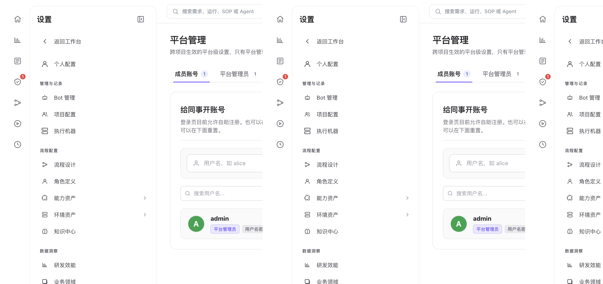
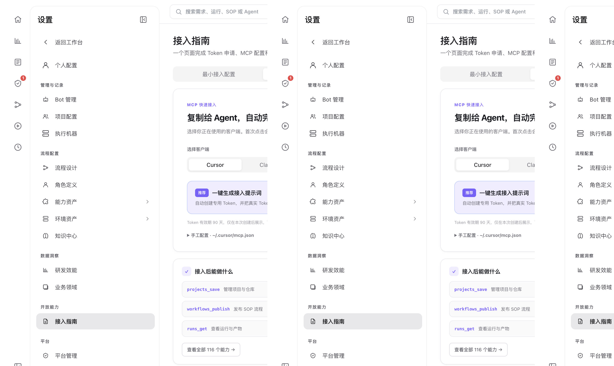

# 平台管理、开放 API 与 Local 版

> **配置与扩展 · 07** · 面向团队管理员与进阶开发者：在「平台管理」中开通成员账号，在「接入指南」中获取 API Token 与 MCP 配置，或使用 LoopForge Local 在个人终端运行工作流。

## 平台管理与领域管理（仅平台管理员可见）



如果你是使用第一个注册账号登录的 **平台管理员**，在「设置」菜单最底部会比普通成员多出一个 **「平台」** 分组：

1. **平台管理（Platform Admin）**
   * **成员账号（Accounts）**：当你们通过 `.env` 中的 `AGENTFLOW_ALLOW_SIGNUP=false` 关闭了登录页的公开注册后，管理员可以在 **「平台管理 → 成员账号」**（给同事开账号）中直接为新同事创建用户名和初始密码，或在同事忘记密码时一键重置。
   * **平台管理员（Admins）**：维护拥有全站管理权限的管理员名单。
   * **共享 CodeBuddy Key（给没配 Key 的成员用）**：管理员可以在这里配置一把团队共享的 `CodeBuddy API Key` 并勾选允许使用的模型列表与默认模型。配好之后，**还没有配置个人 Key 的新成员打开工作台就能直接对话和跑 SOP**；而配置了个人 Key 的成员则优先使用自己的 Key，不受模型范围限制。
2. **领域管理（Domain Admin）**
   * 维护公司的业务领域分类（Business Domains）、指定各领域的管理员与汇报查看者，供「业务领域」数据看板汇总使用。

---

## 开放能力：接入指南（MCP 快速接入与 API Token）



进入 **「设置 → 开放能力 → 接入指南」**。这一页专为希望用外部程序、脚本或自己的 IDE 客户端连接 LoopForge 的进阶用户准备（**零代码新手平时无需打开此页**）：

* **页面操作 vs 程序接入同源**：你在网页上创建的项目、角色和 SOP，与通过 HTTP REST API 或 MCP 工具（如 `projects_save`、`agents_save`、`workflows_save`）读写的是完全同一份数据。
* **5 大功能标签页**：
  1. **最小接入配置**：一目了然地检查当前账号的必配凭证是否就绪。
  2. **MCP 快速接入**：选择你正在使用的客户端（如 Claude Code、Cursor、CodeBuddy 等），一键复制现成的客户端原生 MCP 配置 JSON。
  3. **我的 Token**：点击右上角 **「＋ 创建个人 Token」**，生成用于 API 或 MCP 鉴权的个人访问令牌（请妥善保存首次显示的 Token 明文）。
  4. **能力清单**：按分组浏览并检索平台开放的所有 MCP 工具名称与用途说明。
  5. **REST API / OpenAPI 契约**：在线查阅完整的 HTTP 接口列表，或点击右上角 **「OpenAPI 契约」** 下载标准 `openapi.yaml` 规范文件。

---

## LoopForge Local：不装服务端，在个人 CLI 里跑工作流

如果你是个人开发者，暂时不想部署 Docker 服务端，也可以使用 **LoopForge Local** 把内置的标准化交付工作流直接装进你本地的编码 CLI（需本地安装 Node.js 20+ 与 Python 3.8+）：

```bash
# 1. 检查本地环境依赖是否齐全
npx -y loopforge-cli@latest doctor

# 2. 在你的代码项目目录下安装到对应宿主（支持 claude / codex / cursor / codebuddy）
npx -y loopforge-cli@latest install claude

# 3. 查看安装状态
npx -y loopforge-cli@latest status claude
```

安装完成后，直接在你的编码助手里输入以下命令即可启动本地多阶段交付工作流：

* **Claude Code / Cursor / CodeBuddy（Classic 版）**：输入 `/start-devflow "你的需求描述"`
* **Codex（Classic 版）**：输入 `$devflow-codex "你的需求描述"`
* **Pi（Portable 版）**：先运行 `npx -y loopforge-cli@latest skills install pi` 与 `pi install npm:pi-subagents`，然后输入 `/skill:devflow "你的需求描述"`

---

← 上一篇：[Bot 通知与数据看板](06-bots-and-metrics.md) | [返回文档总目录](../README.md) | 下一篇：[新手常见问题与排障速查](../05-faq/01-troubleshooting-and-faq.md) →
