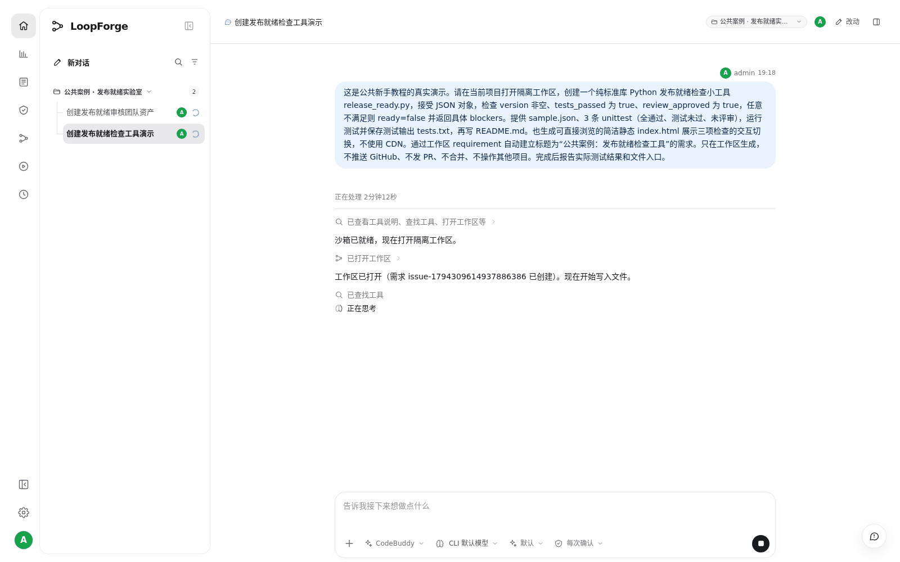
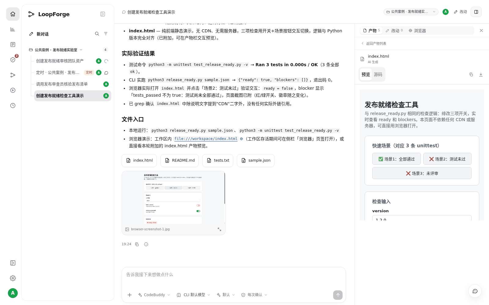

# S01 · 在云端做出第一个小工具

> **真实场景 · S01** · 一句话描述需求，AI 在云端工作区写代码、跑测试，产出可以下载和直接打开的文件。电脑关机了，云端依然在跑。

## 这个案例解决什么问题

想把一句需求变成可运行的小工具，同时留下可核验的测试与文件。

**你要准备的**：版本号、测试通过、人工评审三个条件；输出 ready 与 blockers。


## 第 1 步：在工作台发出明确的需求

新建对话，复制下面这段指令发送。它说清了输入、判断规则、要交的文件和验收方式。

```text
请创建发布就绪检查工具：version 非空、tests_passed=true、review_approved=true 时
ready=true；
否则返回具体 blockers。
生成 Python、3 条测试、sample.json、README 和无 CDN 的交互 HTML。
执行测试，自动建立需求，报告实际结果。
不推送或发布。
```

> 不要只说"帮我做个发布工具"。AI 不知道做到什么程度才算完成。

## 第 2 步：看 AI 在做什么

发送后，消息里会实时出现 AI 的动作：打开工作区、写文件、运行测试、建立需求。





> 发出需求后就可以合上电脑。任务跑在平台的云端工作区里，电脑关机了，云端依然在跑；下次打开同一个会话就能看到结果。

* 中途需要补充，直接在同一个会话里回复。
* 发现方向不对，可以点停止，再补充指令。

## 第 3 步：在右侧查看产物

AI 完成后，消息下方会出现文件卡片。点击 `index.html` 会在右侧打开预览，也可以切到源码或下载。





## 第 4 步：确认真的做完了

| 检查项 | 成功的样子 |
| --- | --- |
| 文件 | 6 个文件都能打开或下载 |
| 测试 | `tests.txt` 里 3 条都是 `ok`，最后是 `OK` |
| 交互 | 切换到"测试未过"，页面显示 `ready=false` 和原因 |
| 需求 | 需求列表里出现"公共案例：发布就绪检查工具" |

不满足时，在原会话里具体描述问题，例如"测试未过时仍显示可发布，期望 ready=false"，让 AI 修复并重跑测试。


## 实测结果

| 实测项 | 结果 |
| --- | --- |
| 产出文件 | 6 个：Python 脚本、测试、sample.json、README、交互 HTML 等 |
| 测试 | 3 / 3 通过；下载到本地重跑同样 3 / 3 通过 |
| 需求单 | 自动建立 1 张 |
| 运行环境 | Docker 沙箱，镜像 python:3.12-slim |


## 要注意的地方

* 这是一个教学用的小工具，没有接代码仓库，也没有提 PR。
* 它说明"一句话到可运行产物"这条路走得通，不代表生产发布质量。

---

← 上一篇：[场景总览](00-overview.md) | [返回文档总目录](../README.md) | 下一篇：[S02 · 和同事在同一个会话里接力](02-shared-session-handoff.md) →
