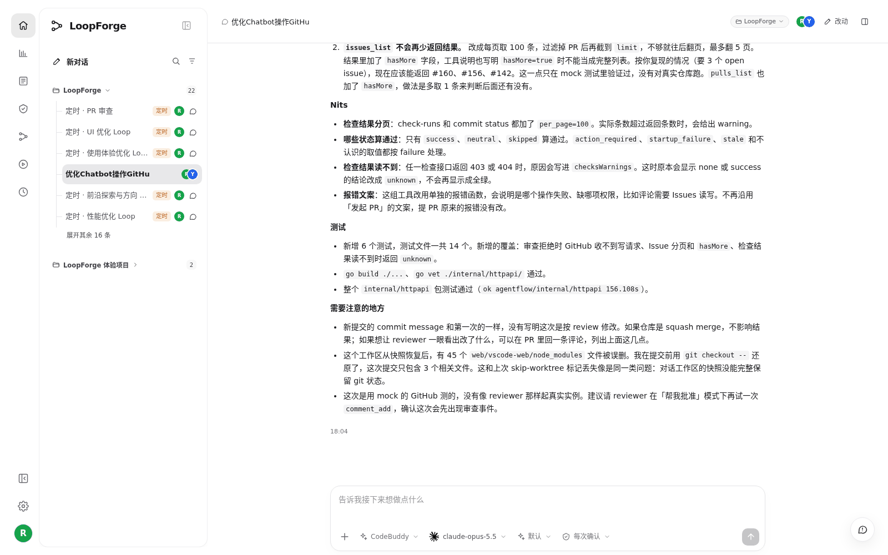

# S02 · 和同事在同一个会话里接力

> **真实场景 · S02** · 需求讨论、实现和 Review 都在同一个会话里完成，接手的人不用重新解释背景。

## 这个案例解决什么问题

需求讨论、实现和 Review 分散在不同对话中，接手的人需要重新解释背景。

**你要准备的**：优化 Main Bot 操作 GitHub 的路径，让轻量查询与评论不必先启动完整工作区。


## 真实案例回顾

LoopForge 团队自己的部署里，两位成员在同一个会话中接力推进"优化 Main Bot 操作 GitHub"：

1. **成员 A** 提出现状问题：Main Bot 操作 GitHub 必须先开工作区，太重。
2. **成员 B** 打开同一个会话，确认范围，授权 AI 提交 PR。
3. AI 实现并测试，提交了 [PR #159](https://github.com/Tencent/LoopForge/pull/159)。
4. 成员 B 贴回实测 Review，AI 在同一个分支上修复。





## 你怎么做

1. 项目负责人先把同事加为项目成员。
2. 把会话链接发给同事，同事用 **自己的账号** 登录打开。
3. 同事先看历史，再说明自己接手哪部分，可以直接用这段：

```text
请继续本会话已有需求，先复述已确定范围、当前分支和待办，再完成我负责的 Review。
给出证据和阻塞原因；
修改后更新原 PR，不新开重复需求。
```

4. 后续修改继续在原会话、原需求、原 PR 里推进，不要另开新单。

## 怎样算成功

两个人的消息都出现在同一份历史里，并且关联的是同一个需求和 PR。

> 出现"会话已更新"的提示时，先刷新加载最新历史再发送，避免覆盖同事的消息。


## 实测结果

| 实测项 | 结果 |
| --- | --- |
| 参与者 | 2 位真人在同一个会话里接力 |
| 产出 | [PR #159](https://github.com/Tencent/LoopForge/pull/159)，并在同一分支追加了 Review 修复 |
| 状态 | 采集时 PR 尚未合并 |


## 要注意的地方

* 这是对已有真实会话的复盘，没有虚构第二个人。
* PR 打开不等于已交付，以合并和验收为准。

---

← 上一篇：[S01 · 在云端做出第一个小工具](01-cloud-first-tool.md) | [返回文档总目录](../README.md) | 下一篇：[S03 · 用聊天把团队经验存成资产](03-save-team-assets.md) →
