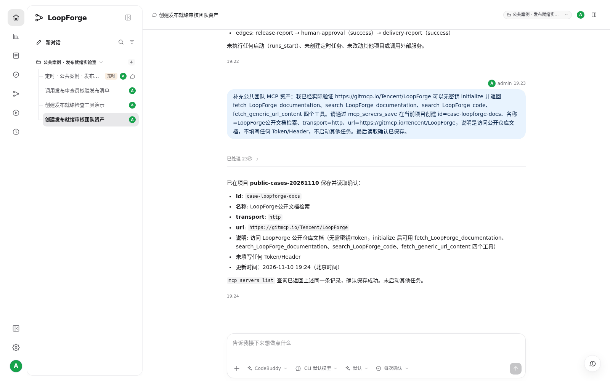
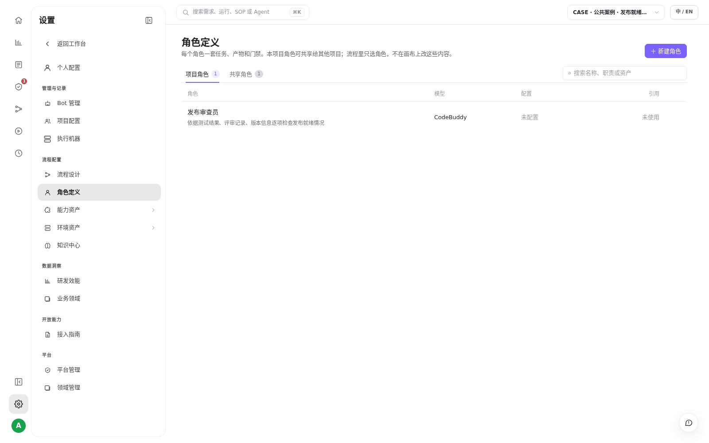
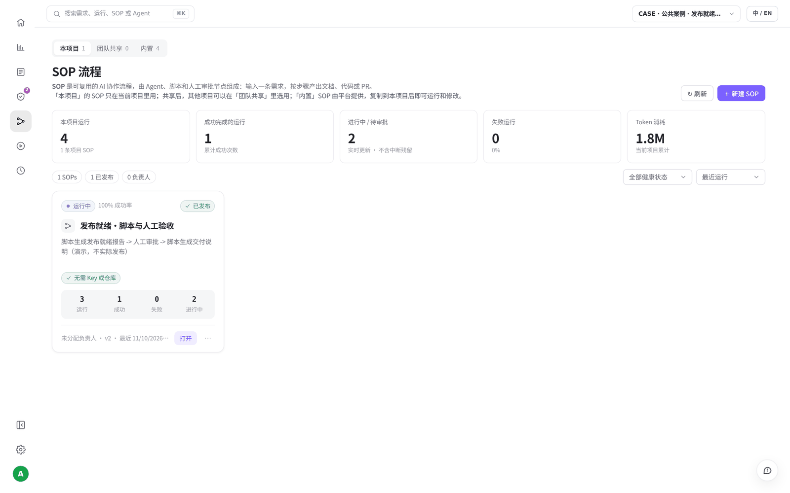
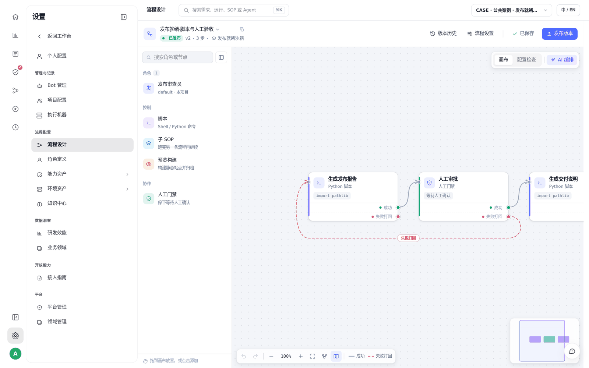
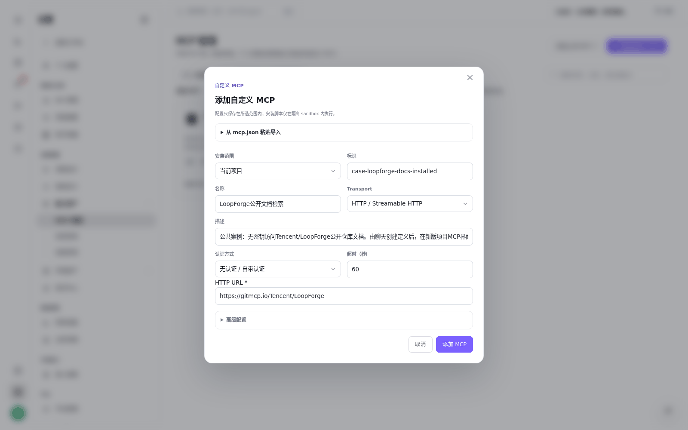
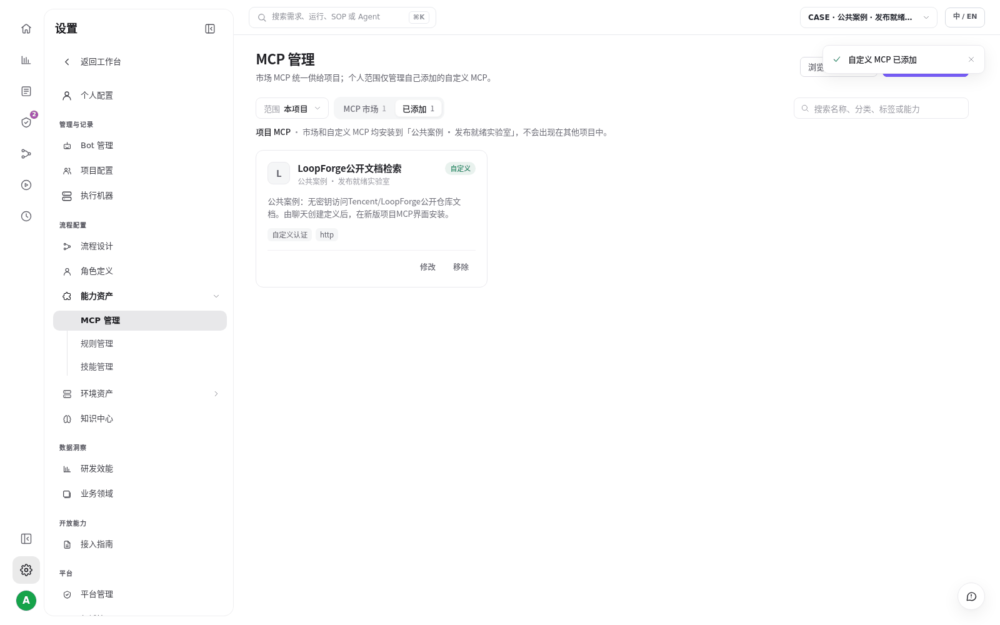

# S03 · 用聊天把团队经验存成资产

> **真实场景 · S03** · 把"谁来做、怎么检查、按什么顺序"存成角色、Skill 和 SOP，以后直接复用，不用每次粘长提示词。

## 这个案例解决什么问题

角色分工和质量清单只存在于长提示词里，难以复用。

**你要准备的**：发布审查员 + 发布就绪清单 + 三节点审批 SOP + 公开文档检索 MCP。


## 第 1 步：说清楚要建什么

| 资产 | 回答的问题 | 本例 |
| --- | --- | --- |
| **角色** | 谁来做、能做什么、不能做什么 | 发布审查员（不自行发布） |
| **Skill** | 按什么清单检查 | 版本、测试、人工评审、回滚方案 |
| **SOP** | 按什么顺序执行 | 生成报告 → 人工审批 → 交付说明 |
| **MCP** | 要连接哪个外部服务 | 公开仓库文档检索（无需 Token） |

## 第 2 步：在聊天里发出创建指令

```text
请在当前项目真实创建“发布审查员”角色、“发布就绪清单”Skill，
以及“生成报告→人工审批→交付说明”SOP。
缺证据必须标未知，禁止自动发布。
保存并发布后列出实际 ID 和版本，并回读验证。
```





## 第 3 步：去页面回读确认

创建完成后，到 **设置 → 角色定义 / 技能管理 / 流程设计** 里确认真的保存了。











## 第 4 步：MCP 要在网页上安装到项目

实测发现：聊天里保存的 MCP 定义，不会自动出现在项目的"已添加"列表里。需要到 **设置 → 能力资产 → MCP 管理 → 添加自定义 MCP**，选择"当前项目"，填写名称和 URL，点击添加。








## 实测结果

| 实测项 | 结果 |
| --- | --- |
| 资产 | 角色、Skill、SOP、MCP 各 1 个，都已保存 |
| SOP | v2 已发布，可被其他人直接使用 |
| MCP | 安装到项目后发现 4 个工具 |


## 要注意的地方

* 聊天里能保存 MCP 定义，但安装到项目要在网页上操作（见第 4 步）。
* MCP 只验证了工具能被发现，没有逐个调用这 4 个工具。

---

← 上一篇：[S02 · 和同事在同一个会话里接力](02-shared-session-handoff.md) | [返回文档总目录](../README.md) | 下一篇：[S04 · 用 @ 调用角色、清单和 SOP](04-mention-assets.md) →
