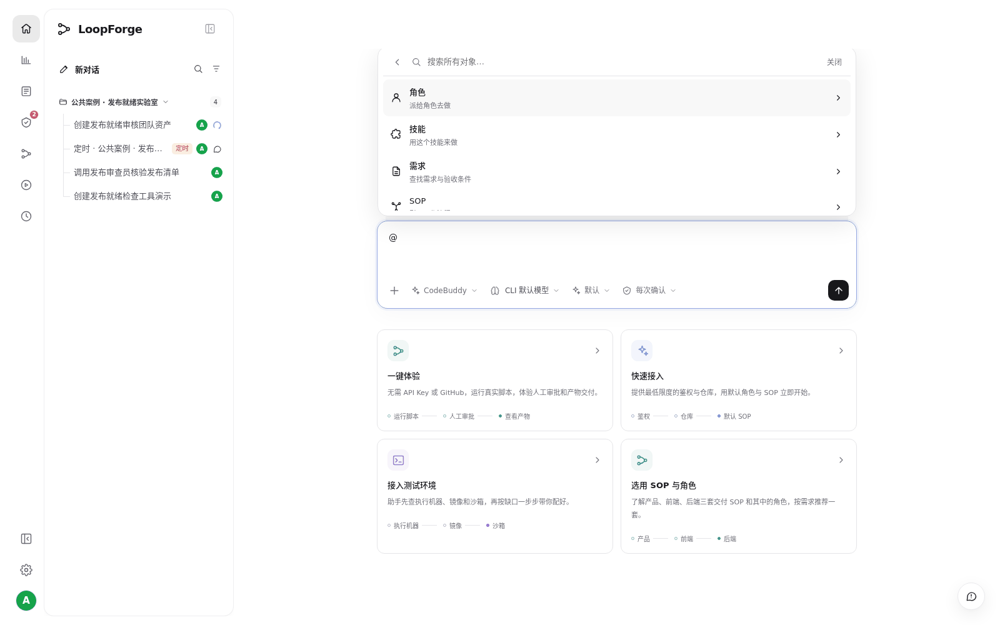
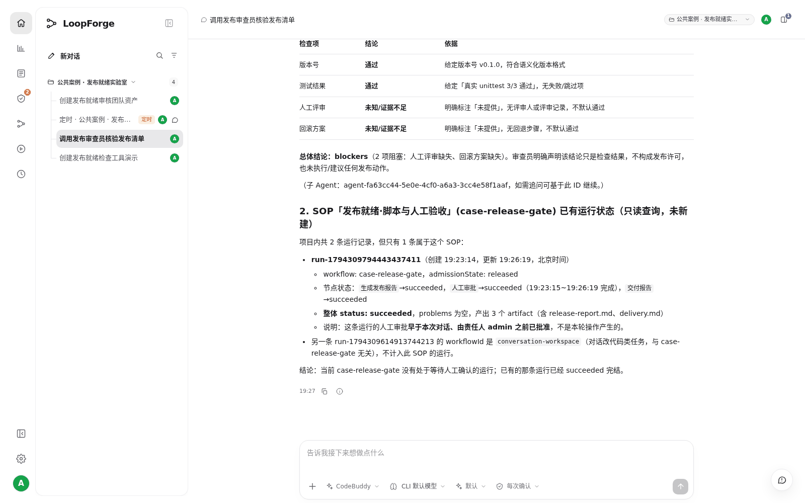

# S04 · 用 @ 调用角色、清单和 SOP

> **真实场景 · S04** · 在输入框里输入 @，直接选中团队资产，让对应角色按清单干活。

## 这个案例解决什么问题

每次都要粘贴角色职责和检查规则，且难以确认谁实际执行了任务。

**你要准备的**：@发布审查员、@发布就绪清单、@发布就绪·脚本与人工验收。

> **在你自己的部署里**：先做完 S03，项目里才有可以 @ 的「发布审查员」「发布就绪清单」和 SOP。


## 第 1 步：输入 @ 选择资产

在输入框输入 `@`，弹出选择器，按名称搜索并选中角色、Skill 或 SOP。选中后输入框里会出现引用标签。





> 只手打名字不算选中。一定要从选择器里点选，出现标签才行。

## 第 2 步：写清楚要它做什么

下面是本次实测发出的原文：

```text
请调用 @发布审查员 子角色，按照 @发布就绪清单 核验这些演示证据：版本 v0.1.0；
真实 unittest 3/3通过；
人工评审未提供；
回滚方案未提供。
要求给出每项依据和 ready/blockers，不可把未知当通过。
同时只读查询 @发布就绪·脚本与人工验收 已有运行的状态，不新建运行、不代替人审批、
不改代码、不执行发布。
请实际调用角色而不是模拟角色口吻。
```

这段指令说清了：用哪个角色、按哪个清单、现有证据是什么、只查询不启动。

## 第 3 步：确认它真的用了这些资产





* 看活动记录里有没有调用 Agent 和 Skill 的动作，不要只看 AI 自己说"我以某角色回答"。
* 缺少证据时，正确的结果是 **列出阻塞项**，而不是默认通过。本例返回了 2 项：人工评审和回滚方案未提供。

> `@SOP` 只是把流程带进上下文，**不会自动启动**。要启动请看 S05 和 S08。


## 实测结果

| 实测项 | 结果 |
| --- | --- |
| 调用记录 | 活动记录里有 Agent 和 Skill 的真实调用 |
| 检查结论 | 2 项阻塞：人工评审、回滚方案缺少证据 |
| 副作用 | 没有执行发布 |


## 要注意的地方

* `@` 只是引用，不会启动 SOP。本例明确要求只查询。

---

← 上一篇：[S03 · 用聊天把团队经验存成资产](03-save-team-assets.md) | [返回文档总目录](../README.md) | 下一篇：[S05 · 让 AI 每天定时干活](05-scheduled-jobs.md) →
