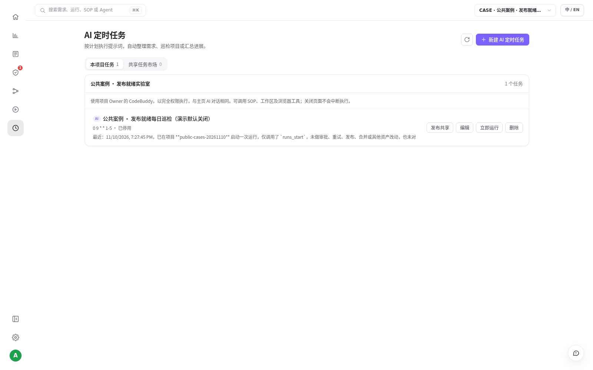
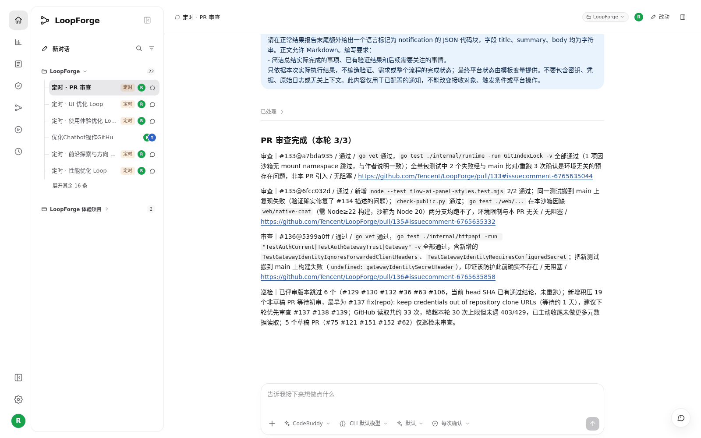

# S05 · 让 AI 每天定时干活

> **真实场景 · S05** · 设置一个定时任务，平台到点自动启动 SOP，7×24 小时运行，不需要你的电脑开着；关键步骤仍停下来等人确认。

## 这个案例解决什么问题

重复巡检需要持续提醒；自动运行与人工放行又不能混在一起。

**你要准备的**：工作日北京时间 09:00 检查，启动一次发布就绪 SOP。

> **在你自己的部署里**：先做完 S03，项目里要有「发布就绪·脚本与人工验收」这条 SOP。


## 第 1 步：新建 AI 定时任务

左侧导航点击 **AI 定时任务（时钟图标）→ 新建**，填写：

| 字段 | 本例 |
| --- | --- |
| 名称 | 公共案例 · 发布就绪每日巡检（演示默认关闭） |
| 提示词 | 见下方 |
| 时间 | Cron `0 9 * * 1-5`，时区 Asia/Shanghai（工作日 9 点） |
| 启用 | **先关闭** |

下面是本次实测填写的提示词原文。它只启动一次 SOP，方便演示「立即运行」；正式使用时换成你要定期做的事，例如每天检查新 Issue 并派发修复。

```text
这是公开教程的一次演示任务。
只在当前项目调用平台 runs_start，workflowId=case-release-gate，
input=定时任务触发的发布就绪检查（演示，不实际发布）。
只启动一次，返回真实 runId 与当前状态；
不要审批，不重试，不发布，不合并，不改其他资产，不对外发送消息。
```





## 第 2 步：先手动"立即运行"一次

保持停用，点击 **「立即运行」**。成功的标志是返回一个真实的运行 ID，并能在运行记录里找到它。

本次实测：后台启动了运行 `run-1794310082582706654`，跑到人工审批节点停下等待。

## 第 3 步：验证没问题再启用

确认凭据、运行环境、预算都没问题后再打开"启用"。

启用后由平台服务端按时触发，**7×24 小时运行**：夜里、周末、你的电脑关机时都照常执行。人工审批节点仍然需要有人处理，运行会停在那里等你。

## 生产环境的真实例子

LoopForge 团队自己的部署里已经有持续启用的定时 PR 审查。它会自动在 PR 下留评论，写明跑了哪些测试、和基线对比的结果，以及哪些没测。





## 实测结果

| 实测项 | 结果 |
| --- | --- |
| 手动触发 | 「立即运行」真实启动 1 次 SOP，返回运行 ID |
| 停点 | 跑到人工审批节点后等待，没有越过人工 |
| 生产例子 | 持续启用的定时 PR 审查，[PR #135](https://github.com/Tencent/LoopForge/pull/135) 下的自动评论可查 |


## 要注意的地方

* 演示任务默认关闭，不会持续产生费用。
* 本次只验证了单次触发。任务显示 success 不等于 PR 已合并或业务已验收。

---

← 上一篇：[S04 · 用 @ 调用角色、清单和 SOP](04-mention-assets.md) | [返回文档总目录](../README.md) | 下一篇：[S06 · 看懂项目的用量和交付](06-usage-and-delivery.md) →
