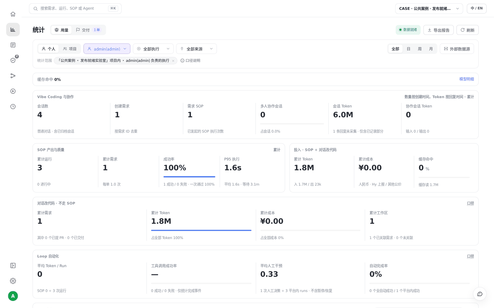

# S06 · 看懂项目的用量和交付

> **真实场景 · S06** · 在一个页面里看到：跑了多少、交付了多少、花了多少 Token、每个成员的情况。

## 这个案例解决什么问题

只知道 AI“跑了很多”，不知道完成了什么、花在了哪里。

**你要准备的**：项目、日期范围、成员，以及会话与 SOP 的不同统计口径。


## 第 1 步：打开统计页

左侧导航点击 **统计（柱状图图标）**。先在顶部选好项目和时间范围。





## 第 2 步：分开看"用量"和"交付"

* **用量**：Token（输入、输出、缓存）、成本估算、缺失采集。
* **交付**：需求数、SOP 运行状态、MR 是否合入。

可以切换"个人 / 项目"口径，也可以按成员查看明细。

## 第 3 步：读数时注意三件事

1. **会话和工作区的用量可能重叠**，不能直接相加当总花费。
2. **共享会话的用量**是整个会话的，不等于某个成员的个人账单。
3. **"未采集"不等于 0**；价格未知时显示 0 也不代表免费。

> 本次 S01 一次对话的实际用量是 1,763,529 Tokens。Token 数包含多轮上下文和工具结果，不是代码字数。

## 可以直接让 AI 帮你分析

```text
只读分析当前项目最近7天：分别列出需求交付、SOP状态、会话Token、缺失采集与成本状态；
保留来源和筛选条件。
不要把PR待合并当已交付，不要把共享会话整体用量当某位成员个人账单。
```


## 实测结果

| 实测项 | 结果 |
| --- | --- |
| S01 的用量 | 一次对话 1,763,529 Tokens |
| 缺失数据 | 单独标记为"未采集"，不按 0 计算 |
| 统计口径 | 会话和工作区的用量分开展示，不相加 |


## 要注意的地方

* Token 包含多轮上下文、缓存和工具结果，不是代码字数。
* 价格未知时成本显示 0，不代表免费。
* 共享会话的用量不等于个人账单或个人绩效。

---

← 上一篇：[S05 · 让 AI 每天定时干活](05-scheduled-jobs.md) | [返回文档总目录](../README.md) | 下一篇：[S07 · 在本地 IDE 里使用云端平台](07-local-ide-mcp.md) →
