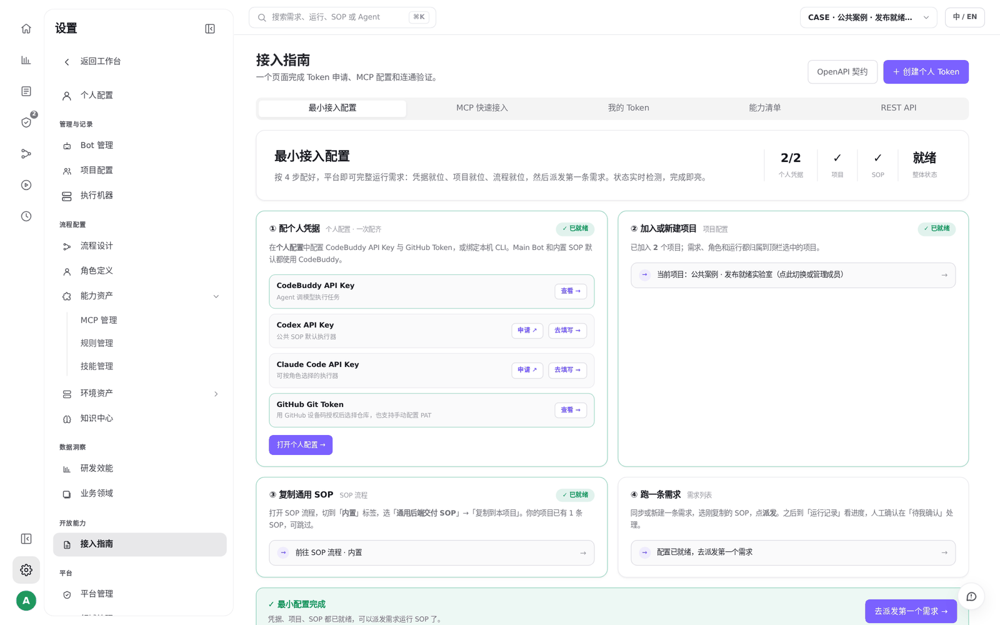

# S07 · 在本地 IDE 里使用云端平台

> **真实场景 · S07** · 用 MCP 把你本地的 Codex、Cursor、Claude Code、CodeBuddy 接到 LoopForge，不切网页也能查项目、派流程。

## 这个案例解决什么问题

希望保留本地工作方式，同时读写团队项目与云端流程。

**你要准备的**：用户级 MCP 配置、个人 Token、完整 HTTPS /mcp 地址。

> **在你自己的部署里**：本地装好一个支持 MCP 的客户端：Codex、Cursor、Claude Code、CodeBuddy 之一。


## 先分清两种 MCP

| 方向 | 在哪里配置 | 例子 |
| --- | --- | --- |
| 平台 → 外部服务 | 设置 → MCP 管理 | S03 里的文档检索 MCP |
| **本地 Agent → 平台** | **设置 → 接入指南** | 本篇要做的事 |

两者的凭据不通用。

## 第 1 步：打开接入指南

**设置 → 开放能力 → 接入指南**。页面会检查你的凭据、项目、SOP 是否就绪，并提供 MCP 快速接入。





## 第 2 步：下载安装说明并创建个人 Token

用 curl 下载对应环境的安装说明（不要用 fetch）：

```bash
curl -fsSL https://<你的 LoopForge 地址>/mcp-setup.txt -o /tmp/loopforge-mcp-setup.txt
```

然后在接入指南里点 **「创建个人 Token」**。

## 第 3 步：合并到你的客户端配置

先备份原配置，只新增 LoopForge 这一项，保留其他 MCP。

Codex（`~/.codex/config.toml`）：

```toml
[mcp_servers.loopforge]
url = "https://<你的 LoopForge 地址>/mcp"
http_headers = { Authorization = "Bearer <你的个人 Token>" }
```

Cursor / CodeBuddy（用户级 JSON）：

```json
{
  "mcpServers": {
    "loopforge": {
      "type": "streamable-http",
      "url": "https://<你的 LoopForge 地址>/mcp",
      "headers": { "Authorization": "Bearer <你的个人 Token>" }
    }
  }
}
```

## 第 4 步：重载客户端，试一下

在本地客户端里发一句话试试，例如（示例写法）：

```text
使用 LoopForge MCP：先列出我能访问的项目，选择“公共案例 · 发布就绪实验室”，
只读列出需求和SOP。
确认真实ID后再启动指定SOP；
返回runId，并查询节点状态。
不要猜项目ID，不要输出任何密钥。
```

## 怎样算成功

工具列表里出现 LoopForge 的工具（本次实测的两个部署各 116 个），能列出你的项目。

| 报错 | 先检查 |
| --- | --- |
| 401 | 个人 Token 是否正确，是否带 `Bearer ` 前缀 |
| 404 | 地址是否以 `/mcp` 结尾 |
| 301 | 改用同域名的 `https://` 地址 |
| 看不到新工具 | 配置语法、作用域，然后重启客户端 |


## 实测结果

| 实测项 | 结果 |
| --- | --- |
| 验证范围 | 2 个 LoopForge 部署都接入成功 |
| 工具数 | 每个部署 116 个 MCP 工具 |
| 实际操作 | 在本地查询项目、创建演示资产、启动云端 SOP |


## 要注意的地方

* 改完配置后，有的客户端要重启才能看到新工具。
* 地址要用 https；实测用 http 会返回 301。
* 个人 Token 只放在本地配置里，不要写进文档或截图。

---

← 上一篇：[S06 · 看懂项目的用量和交付](06-usage-and-delivery.md) | [返回文档总目录](../README.md) | 下一篇：[S08 · 把需求交给 SOP 跑完](08-requirement-through-sop.md) →
