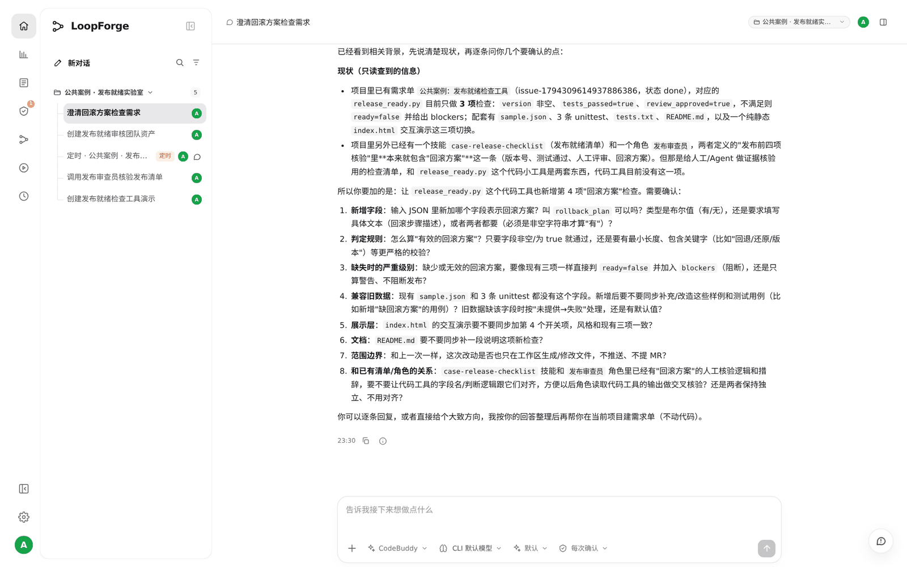
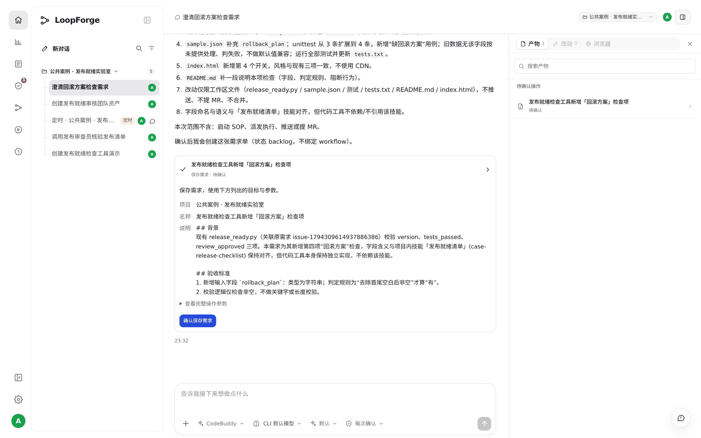
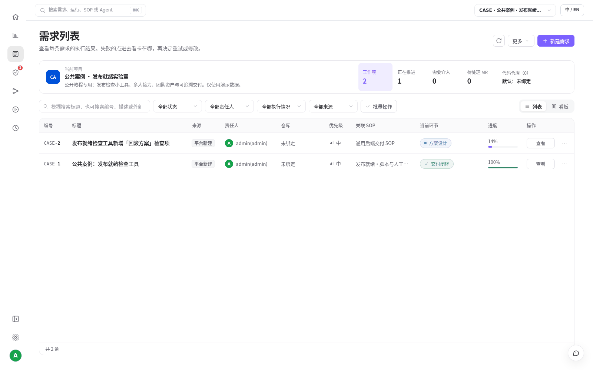
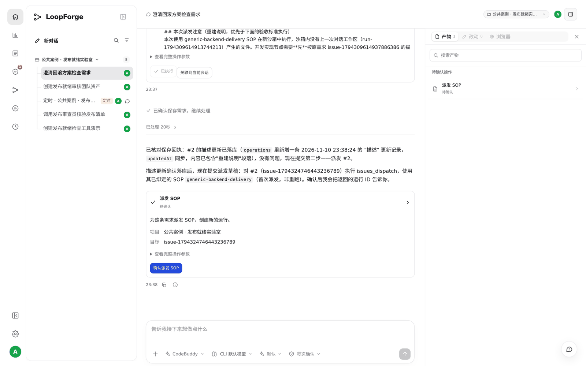
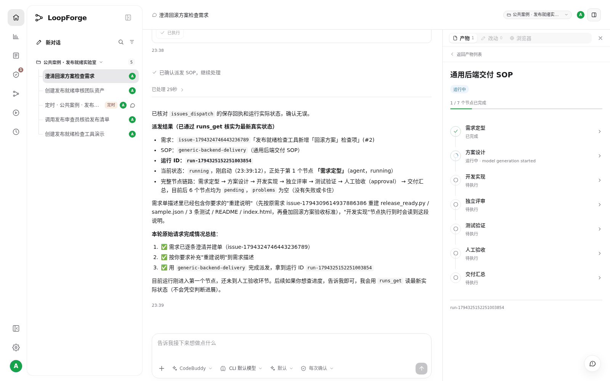
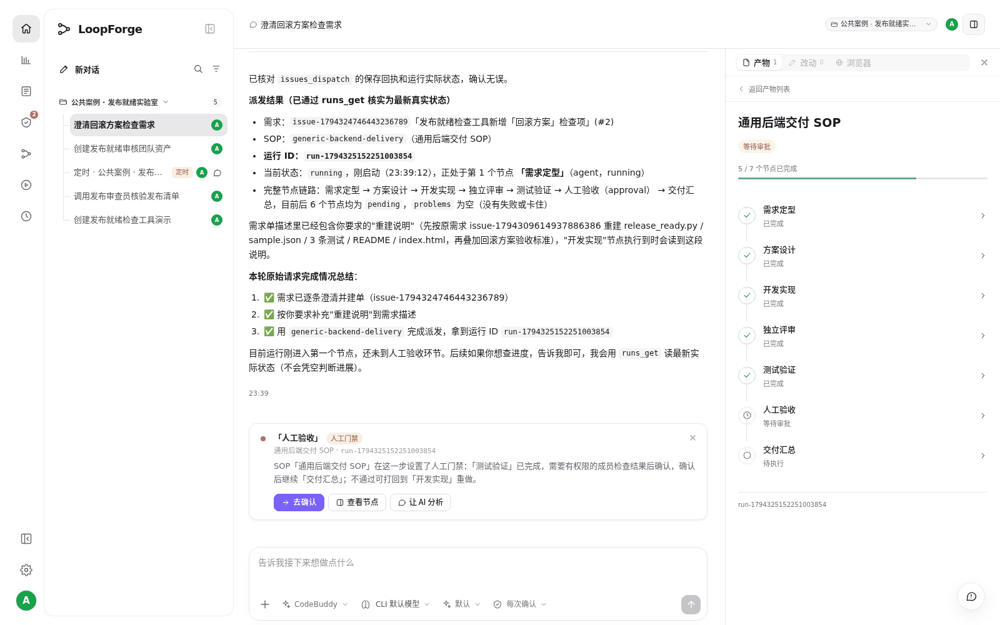
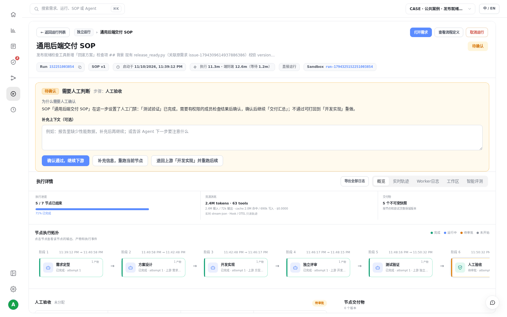
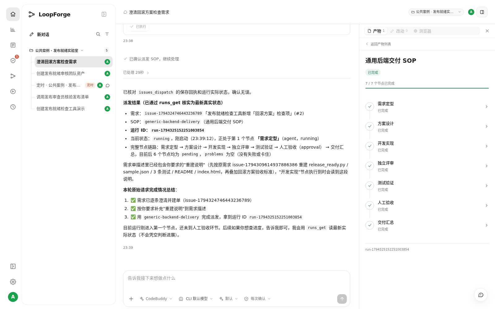

# S08 · 在对话里澄清需求，交给 SOP 跑完

> **真实场景 · S08** · 不用离开对话：先把需求聊清楚，AI 自动建好需求单；再从对话里发起 SOP，在会话侧边栏里看着它一个节点一个节点跑完。

> **在你自己的部署里**：只需要配好模型凭据。本例用的是平台内置的「通用后端交付 SOP」（`generic-backend-delivery`），不需要代码仓库，也不需要先做 S03。本例是在 S01 那个小工具上加一项检查；你也可以换成自己的任何需求，流程完全一样。

## 这个案例要说明什么

一句话：**需求在对话里聊清楚，就自动变成需求单；从同一个对话发起 SOP，执行过程就在侧边栏里看得见。**

| 你想做的事 | 在哪里完成 | 看到什么 |
| --- | --- | --- |
| 把模糊的想法变成验收标准 | 对话 | AI 逐条反问，你逐条回答 |
| 建需求单 | 对话里点确认 | 需求列表里多出一张单，来源「平台新建」 |
| 发起 SOP | 对话里点确认 | 拿到运行 ID |
| 看执行过程 | 会话右侧边栏 | 7 个节点逐个变成「已完成」 |
| 关键一步由人拍板 | 对话里的人工门禁卡片 | 你确认后才继续交付 |

本例的会话权限是 **「每次确认」**：AI 每次要建单、改单、派发，都会先出一张确认卡片，你点了才会真正执行。

## 第 1 步：让 AI 帮你澄清需求

新建一个对话，先说清楚"只澄清、不写代码"：

```text
我想给「发布就绪检查工具」加一项"回滚方案"检查。
先别动手写代码，帮我把需求澄清清楚：有不确定的地方逐条问我，
问清楚以后再帮我在当前项目建一张需求单。
```

AI 先读了项目里已有的需求单和资产，然后列出 8 个要你确认的问题：字段叫什么、怎么算"有"、缺了算阻断还是警告、旧数据怎么处理、页面和文档要不要改、范围边界、和已有 Skill 的关系。





## 第 2 步：回答问题，自动建需求单

逐条回答，并说明"先只建单，不启动 SOP"：

```text
逐条回复：
1. 字段叫 rollback_plan，必须是非空字符串（去掉首尾空白后）才算有。
2. 只校验非空，不做关键字或长度校验。
3. 缺少或为空时阻断：ready=false，并在 blockers 里写明"缺少回滚方案"。
4. sample.json 补上 rollback_plan；
测试新增一条"缺回滚方案"的用例，共 4 条。
旧数据没有这个字段按未提供处理，判失败。
5. index.html 加第 4 个开关，风格和现有三项一致。
6. README 补一段说明。
7. 只在工作区改文件，不推送、不提 MR。
8. 字段名和含义与「发布就绪清单」对齐，代码工具本身保持独立。
信息够了的话，请在当前项目建一张需求单，把以上结论写成验收标准。
先只建单，不要启动 SOP。
```

AI 把你的回答整理成 8 条验收标准，弹出 **「保存需求 · 待确认」** 卡片。右侧边栏的「待确认操作」里也能看到它。





点 **「确认保存需求」**，需求单就建好了。打开左侧 **需求列表**，能看到这张新单 CASE-2，来源是「平台新建」，关联的 SOP 已经填好：





## 第 3 步：在对话里发起 SOP

不确定用哪条 SOP 时，可以先让 AI 列一下：

```text
准备派发 #2。
先列出当前项目能用的 SOP（包括内置模板），说明每条的节点、是否需要代码仓库、
能不能在没绑仓库的情况下在沙箱里真正改文件。
先别派发，等我选。
```

AI 列出项目里可用的 SOP，并说明哪条不需要代码仓库也能在沙箱里改文件。选好后让它派发：

```text
用 generic-backend-delivery 派发 #2。
注意：新沙箱里没有上次对话工作区的文件，开发节点请按原需求 issue-1794309614937886386
的描述先重建 release_ready.py、sample.json、测试和 index.html，再按 #2
的验收标准加回滚方案检查。
不推送、不提 MR。
派发后告诉我运行 ID。
```

> 为什么要多交代一句"先重建文件"：SOP 每次都在 **新的沙箱** 里运行，看不到 S01 对话工作区里的文件。如果你的需求是从零开始做，或者项目接了代码仓库，就不需要这句话。

AI 发现 SOP 的节点读的是需求单本身的描述，所以先把这段"重建说明"补进需求单（又出一张「保存需求」卡片），确认后再出一张 **「派发 SOP · 待确认」** 卡片：





点 **「确认派发 SOP」**，AI 回复运行 ID `run-1794325152251003854`，以及完整的节点链路。

## 第 4 步：在会话侧边栏看执行过程

点对话右上角的 **产物** 按钮打开侧边栏，「SOP 运行」下面就是刚派发的这次运行。点进去，能看到每个节点的状态和整体进度：





| 节点 | 做了什么 |
| --- | --- |
| 需求定型 | 把需求单整理成 `requirement.md` |
| 方案设计 | 写出 `design.md` |
| 开发实现 | 重建原工具，再加上回滚方案检查 |
| 独立评审 | 独立重跑测试、逐条核对验收标准 |
| 测试验证 | 再独立跑一遍，自己构造 6 组用例 |
| 人工验收 | 停下来等人确认 |
| 交付汇总 | 写出 `delivery.md` |

每个节点右边的箭头可以点开，看这个节点的输出。

## 第 5 步：在对话里处理人工验收

跑到「人工验收」时，侧边栏显示 **等待审批**，对话里同时出现一张 **人工门禁** 卡片，写明为什么要你确认、确认后会发生什么：





点 **「去确认」** 会打开这次运行的详情页。读完上游的评审和测试结论后，选择是否通过：





| 你的选择 | 结果 |
| --- | --- |
| **确认通过，继续下游** | 继续执行「交付汇总」 |
| **补充信息，重跑当前节点** | 带着你的意见重跑 |
| **退回上游「开发实现」** | 从开发节点重新做 |

## 第 6 步：确认跑完

确认后，最后一个节点自动执行。回到对话，侧边栏显示 **7 / 7 个节点已完成**；需求列表里 CASE-2 的进度也变成 100%、「交付闭环」。





## 和 S04、S05 有什么不同

* **S04**：在聊天里 `@SOP` 只是把流程当参考资料，不会启动运行。
* **S05**：定时任务到点 **自动** 启动 SOP。
* **S08**：在对话里澄清需求、建单、**手动** 发起 SOP，并在对话里看到执行过程、做人工决定。

## 实测结果

| 实测项 | 结果 |
| --- | --- |
| 对话 | 4 条消息，3 次确认（建单、补充说明、派发） |
| 需求单 | CASE-2「发布就绪检查工具新增「回滚方案」检查项」，8 条验收标准，来源「平台新建」 |
| SOP 运行 | 「通用后端交付 SOP」v1，`run-1794325152251003854`，7 / 7 节点完成，7 份产物 |
| 测试 | 4 / 4 条 unittest 通过；评审、测试、交付 3 个节点各自独立重跑，结论都是通过 |
| 耗时与用量 | 共约 15 分钟，其中约 1.5 分钟在等人工确认；约 306 万 Tokens |


## 要注意的地方

* SOP 在新的沙箱里运行，看不到对话工作区里的文件。要基于已有代码改，最好给项目接上代码仓库；没有仓库时，要像本例这样在需求里写清楚怎么重建。
* 本例的人工验收是作者本人点的，只确认教程流程，不代表真实的产品发布授权。
* 本例没有推送代码、没有提 MR，所有改动只在这次运行的沙箱里。

---

← 上一篇：[S07 · 在本地 IDE 里使用云端平台](07-local-ide-mcp.md) | [返回文档总目录](../README.md)
