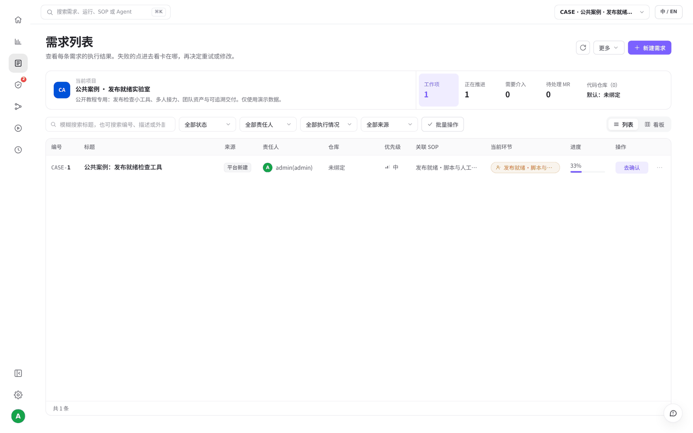
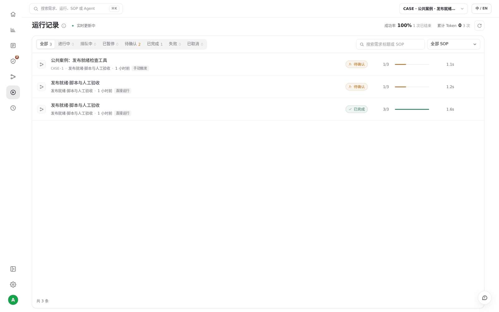
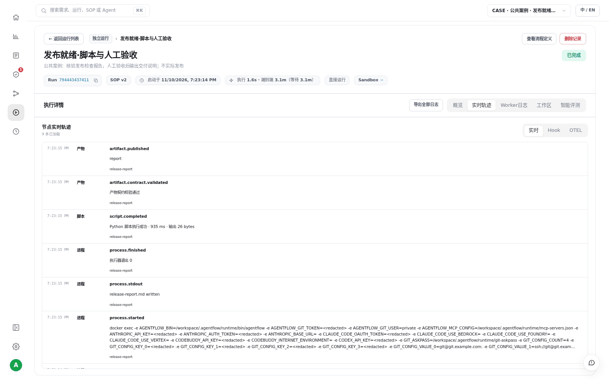
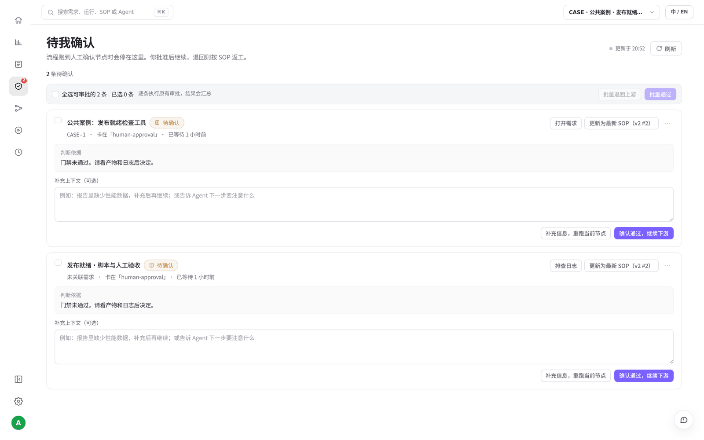
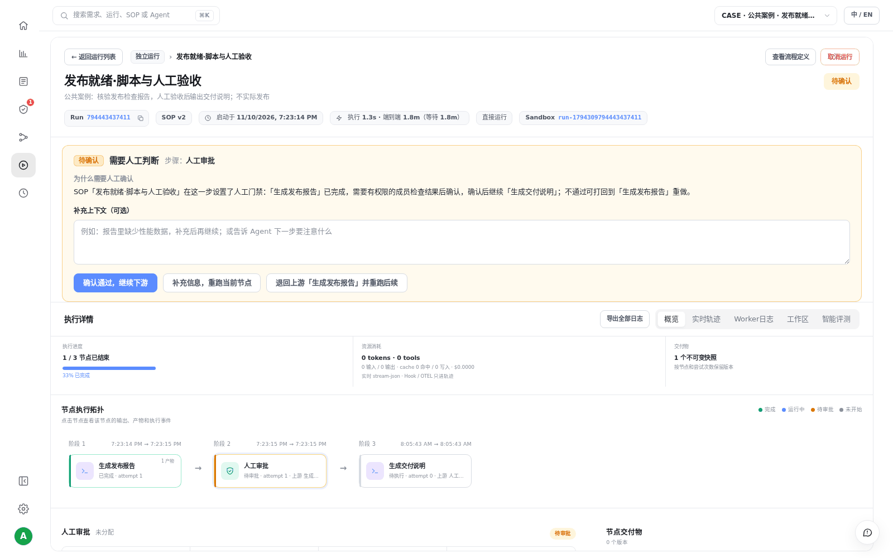
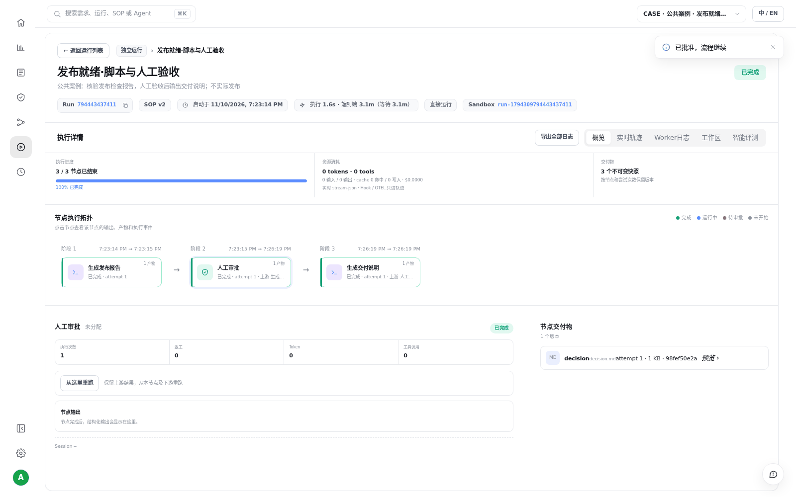

# S08 · 把需求交给 SOP 跑完

> **真实场景 · S08** · 聊天适合探索；正式交付要按固定步骤走。AI 按 SOP 一步步执行，到关键节点停下来等你拍板，每一步都留下记录。

## 这个案例要说明什么

一句话：**正式需求不靠 AI 一句"做好了"，而是按团队定好的流程走完，关键一步由人决定。**

| | 只在聊天里做（S01） | 交给 SOP 做（本篇） |
| --- | --- | --- |
| 步骤 | AI 临场决定 | 固定：生成报告 → 人工审批 → 交付说明 |
| 怎样算完成 | AI 说完成了 | 每个节点都有产物，审批节点必须有人点通过 |
| 事后回查 | 翻聊天记录 | 需求、运行、节点、产物串成一条链 |

## 整个过程

1. 在 **需求列表** 打开一张需求单，选一条 SOP，点启动。
2. AI 自动执行前面的节点，生成检查报告。
3. 运行停在 **人工审批** 节点，"待我确认"亮起红点。
4. 你读完报告后点通过，AI 继续执行剩下的节点，生成交付说明。
5. 运行完成，每个节点的产物都留有快照。

下面用 S01 自动建立的那张需求单，把这 5 步真实走一遍。

## 第 1 步：从需求单启动 SOP

左侧导航点击 **需求列表**，找到「公共案例：发布就绪检查工具」。打开它，选择已发布的 SOP「发布就绪 · 脚本与人工验收」，点击 **「启动 SOP」**。





也可以在对话里让 AI 代你启动，指令要说清楚不要重复建单、到审批节点停下：

```text
把“发布就绪检查工具”的目标和验收标准写进已有需求，不要重复建单。
绑定已发布的发布就绪SOP并启动；
返回需求ID、Task ID、Run ID、SOP版本。
到人工验收节点停下，展示具体产物与trace入口。
```

## 第 2 步：AI 自动执行前面的节点

启动后到 **运行记录** 打开这次运行，能看到当前跑到哪个节点。








## 第 3 步：停在审批节点，由你拍板

跑到人工审批节点时，运行会暂停，左侧 **待我确认** 图标出现红色数字。点进去先读上游节点生成的报告，再做决定。








| 你的选择 | 结果 |
| --- | --- |
| **确认通过** | 继续执行下游节点 |
| **补充信息** | 带着你的意见重跑当前节点 |
| **退回上游** | 从上游节点重新执行 |

## 第 4 步：确认运行完成

审批通过后，剩下的节点自动执行完。运行详情里 3 个节点全部完成，每个节点的产物都保存了快照，之后修改 SOP 也不会改变这次的记录。





## 出问题时去哪里看

| 想知道 | 去看 |
| --- | --- |
| 卡在哪个节点 | 运行详情 → 概览（节点拓扑和状态） |
| 每一步发生了什么 | 运行详情 → 实时轨迹 |
| 命令具体报了什么错 | 运行详情 → Worker 日志 |
| 当时用的哪个流程版本 | 运行详情里记录的 SOP 版本 |

## 和 S04、S05 有什么不同

* **S04**：在聊天里 `@SOP` 只是把流程当参考资料，不会启动运行。
* **S05**：定时任务到点 **自动** 启动 SOP。
* **S08**：你 **手动** 从需求单启动 SOP，并在审批节点做决定。

## 实测结果

| 实测项 | 结果 |
| --- | --- |
| 启动链路 | S01 的需求单 → Task `task-primary-0455cb9dbb15f7ccbecc1aa2` → 运行 `run-1794310178737355658` |
| SOP 版本 | 「发布就绪 · 脚本与人工验收」v2（启动时冻结） |
| 完整走完 | 同版本 SOP 的另一次运行：3 / 3 节点完成，3 份产物快照 |


## 要注意的地方

* 在对话里直接写代码（S01）不会产生 SOP 节点，所以不会出现在运行记录里。只有启动 SOP 才有这条链路。
* 本例的审批只是确认教程流程，不代表真实的产品发布授权。

---

← 上一篇：[S07 · 在本地 IDE 里使用云端平台](07-local-ide-mcp.md) | [返回文档总目录](../README.md)
